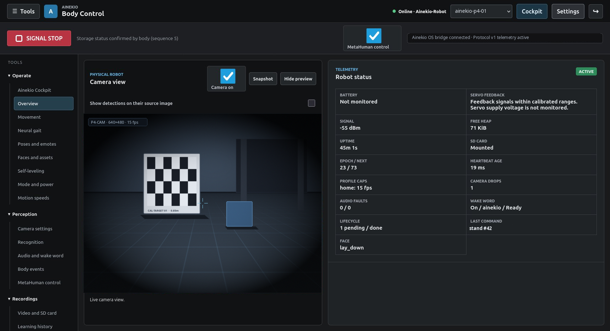

# Ainekio

Ainekio is a compact quadruped robot companion built from custom 3D-printed mechanics, real-time ESP32 firmware, and a Python Body Control gateway, powered by [Ainekio OS](https://github.com/Greg-Aster/ainekio-os) ([ainek.io](https://ainek.io)).

This repository owns the physical chassis, microcontroller firmware, `protocol-v1` transport, local perception, motion execution, and host simulation. Higher-level cognition, persistent memory, speech synthesis, and autonomous decision-making run in [Ainekio OS](https://github.com/Greg-Aster/ainekio-os) across an authenticated Environment Bridge.



## Hardware Generations

- **V2 (Active — 12-servo quadruped)**: Custom 3-DOF-per-leg chassis (`Slave/hardware/v2-12servo/`) running ESP-IDF firmware on an ESP32-P4-WIFI6 with an ESP32-C6 companion radio (`Slave/firmware/esp32p4-wifi6/`). Drives 12 joints via PCA9685 PWM with 16-channel muxed 4th-wire analog position feedback, LSM6DS3 IMU attitude estimation and balance trim, onboard camera streaming and correlated stills, microphone/local wake-word and speaker audio, and an animated LCD face.
- **V1 (Paused — 8-servo quadruped)**: Retained Freenove ESP32-S3 body with direct MCPWM servo drive (`Slave/firmware/esp32s3/`, `Slave/hardware/v1-8servo/`), originally derived from [Sesame](https://github.com/dorianborian/sesame-robot).

Both generations connect through the same `protocol-v1` link and Body Control interface. See [Robot Models](docs/ROBOT_MODELS.md) and [V2 Specifications](docs/v2-12servo/SPECIFICATIONS.md) for hardware contracts; source capabilities and per-device physical qualification are tracked separately.

## Repository Layout

| Path | Responsibility |
| --- | --- |
| `Master/` | Python Body Control gateway (`protocol-v1` WebSocket server), operator dashboard (`127.0.0.1:8791`), camera perception (YOLO, depth, person recognition), Microduck neural gait, and `/environment` bridge ([gateway README](Master/gateway/README.md)) |
| `Slave/firmware/esp32p4-wifi6/` | Active V2 ESP-IDF firmware (`main/app_main.c`), servo/ADC feedback loop, IMU, camera, audio, and LCD face ([firmware README](Slave/firmware/esp32p4-wifi6/README.md)) |
| `Slave/firmware/esp32s3/` | Retained V1 ESP32-S3 firmware (`main/app_main.c`) |
| `Slave/software/` | Portable `protocol-v1` implementation, kinematics/motion models, and tests ([protocol README](Slave/software/protocol/README.md), [V2 motion model](Slave/software/models/v2-12servo/README.md)) |
| `Slave/hardware/` | Printable STLs, CAD assemblies, and mechanical layouts for `v2-12servo/` and `v1-8servo/` |
| `experiments/freestyle/` | Model-backed Freestyle motion generation and host trajectory execution loaded by Body Control ([Freestyle README](experiments/freestyle/README.md)) |
| `Emulator/` | Host `protocol-v1` body emulator, visual simulator, and A1–A30 software acceptance suite |
| `docs/` | Hardware specifications, wiring maps, startup runbooks, and gait/qualification records |

## Quick Start

### Physical V2 Body Control

Start the physical `protocol-v1` listener, operator dashboard, and authenticated `/environment` bridge for an installed V2 robot:

```sh
./Master/start-physical-gateway.sh
```

See [docs/STARTUP.md](docs/STARTUP.md) for required environment variables, port bindings, and running alongside Ainekio OS.

### Host Simulator & Acceptance Suite

Launch the visual simulator, `protocol-v1` body emulator, Body Control gateway, operator dashboard, and `/environment` adapter in a single supervised stack (`Ctrl+C` stops all processes):

```sh
cp .env.example .env
# Set AINEKIO_ENVIRONMENT_ADAPTER_TOKEN to match Ainekio OS
./start.sh
```

Run the A1–A30 software acceptance gates:

```sh
python3 Emulator/tools/run_acceptance.py
```

## Documentation

- [Robot Design Core](https://github.com/Greg-Aster/ainekio-os/blob/main/docs/robot/ROBOT_BIBLE.md) & [Robot Software Architecture](https://github.com/Greg-Aster/ainekio-os/blob/main/docs/robot/SYSTEM_ARCHITECTURE.md) — Shared whole-robot contracts and execution paths in `ainekio-os`
- [Documentation Authority](docs/README.md) & [Repository Map](docs/REPOSITORY_MAP.md) — Source ownership and document index
- [V2 Hardware & Firmware Specifications](docs/v2-12servo/SPECIFICATIONS.md) & [V2 Docs Index](docs/v2-12servo/README.md) — Active 12-servo hardware, wiring, and resource budgets
- [Robot Models](docs/ROBOT_MODELS.md) & [V1 Pinout Diagnostics](docs/v1-8servo/PINOUT_DIAGNOSTICS.md) — Model differences and retained V1 hardware records
