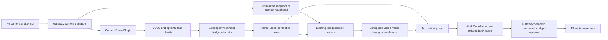

# Camera, recognition and target tracking integration

Status: integration resumed with the live robot on DNDIY; stationary qualification in progress. Q6A qualification remains outstanding.
Audit date: 2026-10-12.

## Working progress

The owner authorized integration after reviewing this audit and the questions
below. Use this file as the execution record: consult the implementation sequence
before each work package, then record changes, tests, unresolved issues and the
next step here. Audit findings remain historical evidence until their resolution
is recorded; do not silently turn an untested proposal into a completed feature.

| Work package | Status | Evidence / next action |
| --- | --- | --- |
| Audit and ownership inventory | Complete | Baseline findings and test results below |
| Integration questions and architecture | Recorded | Existing workflow and bridge; continuous perception with asynchronous reasoning |
| 1. Repair existing evidence flow | In progress | Correct duplicate stale recognition and associate finite image reasoning with its actual frame |
| 2. Visible recognition in Body Control | Source/fixture checks complete; live data verified | Real P4 camera detections and correlated target updates reached MetaHuman on DNDIY; live browser interaction remains to be qualified |
| 3. Shared target/task contract | Source implemented; integration verification in progress | Approved task schema, correlated bridge requests, query IDs and track IDs use existing owners |
| 4. Stationary acquisition and continuity | Live partial proof; reliability incomplete | Actual model search/select and returned evidence verified; moved chair reacquired with changed ID; model routing, detector quality and body disconnects prevent full qualification |
| 5. Requested physical behavior | Planned | Existing task/body owners; physical tests require an available robot |
| 6. Deployment and resource qualification | Desktop pilot installed; qualification incomplete | Live gateway search/select/release passed; connected robot, remote transport, Q6A and mixed workloads remain |

The owner approved desktop pilot installation on 2026-10-11. Body Control now
loads the local YOLOE model and ByteTrack; installation evidence is recorded below.
No firmware flash or physical movement has been performed for this integration.
Earlier entries describe evidence at their recorded stage, before installation.

### Integration entry 1 — Evidence flow and visible recognition

Source changes implemented; focused verification is underway:

- MetaHuman's current recognition projection now includes generic objects and
  the existing person view derived from those same objects. Removed the stale
  raw-perception duplicate from the current selector state; historical stored
  observations remain intact.
- Extracted the existing full camera-identity comparison into the perception
  owner and reused it in selector context and finite image identification.
  Identification receives frame metadata and explicit exact/different-image
  association; its existing model instructions are unchanged.
- The gateway camera worker retains the latest accepted result with its source
  JPEG for all backends. Named-face gallery status no longer owns generic
  observation delivery.
- Body Control has an opt-in detection view on the existing camera endpoint.
  Its JSON result carries the image and observation together; unchanged source
  images are not retransmitted. Overlays display class/name and available
  detector scores. No second capture/inference worker was added.
- Tests so far: MetaHuman perception 7/7; Robot Status/context 12/12, including
  the previously failing stale-name regression and a generic-keys context case.
  Gateway/dashboard: 59/59 passed. Isolated context-builder: 14/14 passed.
  Core type checking passed. Browser checks passed against an isolated synthetic
  dashboard: exact box/image alignment, untrusted label text, two detections,
  switching back to raw video, and no JavaScript exceptions. Desktop and mobile
  screenshots were visually reviewed. This is not actual-model/robot proof.

### Integration entry 2 — Finite target acquisition

The approved localization mode is implemented inside `identifyActiveTaskImage`
and therefore uses the existing `environment.identify` Coordinator handler and
model-router path. It accepts a robot image plus an optional reference image and
returns the owner's approved candidate representation with the original frame
identity. It does not return completion booleans or select physical actions.

The existing target-box normalizer now accepts any positive in-frame box, matching
ordinary recognition's coordinate range; its former arbitrary 1% minimum was
removed. No confidence threshold or candidate-count limit was added. Both focused
mock-provider tests passed (localization outcomes/reference image and existing
remote-provider routing), and updated Core type checking passed. This mode is not yet
connected to target commands or an ongoing tracking task; work packages 3–4
remain outstanding.

### Integration entry 3 — Generic continuity in the existing camera owner

- Optional `--vision-yolo-tracker bytetrack.yaml` (or a local ByteTrack YAML)
  attaches Ultralytics ByteTrack to the existing YOLO backend. Tracking commits
  in the camera worker's existing accepted-frame finalizer, after freshness and
  generation selection; discarded inference cannot update the tracker. Camera
  session/generation changes reset the tracker and its ID namespace.
- Recognized objects carry optional `trackId` through the Python contract,
  existing Environment Bridge telemetry, MetaHuman normalization and Robot
  Status. Body Control's exact-image overlay exposes the ID in its tooltip.
  No additional inference worker, stream or movement command was introduced.
- All detector results remain present, including unconfirmed tracks. Missing
  objects are not emitted from tracker predictions. Named-face recognition uses
  generic association when configured rather than starting a competing box/color
  association; its existing face-evidence lifetime and uncertainty remain.
- Verification: gateway/camera/person/detector/dashboard 63/63; MetaHuman
  perception 8/8; Robot Status 12/12; Core type checking passed. Tests include
  source reset, unmatched detections, shared face/track identity and transport.
- Actual-library smoke test used the already-installed person YOLO weights,
  Ultralytics' packaged `bus.jpg` resized to 320×427, detector size 320 and CPU.
  Four detected people retained four IDs over four repeated images. After the
  first iteration, detection took approximately 79–80 ms; association took
  0.7–11.2 ms. This is a desktop wiring check on a repeated still, not moving-object
  accuracy, YOLOE semantic acquisition, Q6A throughput or physical qualification.
- `lap==0.5.12` was installed only under an isolated `/tmp` test directory with
  the existing Python 3.12 interpreter. Production dependencies/configuration
  are unchanged and tracking remains opt-in. No model weights were downloaded.
- Remaining: text/visual prompts and selected-instance commands, stationary task
  execution, evidence retention while reasoning is busy, actual-model tests,
  deployment and hardware qualification. The historical 32-object detector/parser
  cap is still present; this entry does not claim to resolve it.

### Integration entry 4 — Prompt transport and stationary task source integration

- The existing `environment.visual-read` Coordinator request and Bridge transport
  now also carry finite search/select/release operations and their correlated
  receipts. The existing stream and connection owners are unchanged. Adapter
  configuration runs outside its socket reader; responses retain the originating
  connection. No body lease or movement command is required for these operations.
- Target configuration runs on the same camera executor as inference. Prompt
  changes replace the recognition generation. A configuration is committed only
  after its model preparation succeeds. Visual prompting carries the retained
  reference image bytes and normalized region, rather than applying old
  coordinates to a new camera frame. Observations include the originating query
  ID; explicit release restores the originally configured detector.
- The existing task program now supports the approved vision steps and
  `behavior.motion: null`. Acquisition reads camera evidence through the existing
  request, dispatches the existing finite localization job, retains the source
  image and returns candidate evidence with the task result. It cannot declare the whole
  objective complete. Stationary behavior evaluates its image without creating
  movement or Finish commands. Selected track IDs can feed existing steering;
  existing physical behavior policies have not been replaced.
- The schema advertises search/select only when the configured backend reports
  those operations. Local text encoder and tokenizer dependencies are explicit;
  no runtime dependency installation was added.
- Tests so far: active-task state 72/72; existing camera request/continuation plus
  configuration transport 5/5; focused camera executor/prompt concurrency 1/1;
  YOLO/person unit tests 17/17. Core type checking passes after correcting a
  test-fixture annotation; final combined verification is still underway.
- Actual YOLOE-26n visual-reference smoke test used official 11.1 MiB weights in
  `/tmp`, the packaged bus image, CPU, and detector size 320. The selected bus was
  detected at about 0.919 model confidence and retained its ID over three repeated
  images. Prompt setup took about 264 ms; inference plus association took
  22–23 ms/frame on the desktop. This does not establish identity discrimination,
  moving-scene accuracy, Q6A speed or robot behavior. The first actual run exposed
  a detection/segmentation predictor mismatch; using the matching Ultralytics
  visual-prompt predictor resolved it.
- Body Control now exposes text search, detection selection and release through
  its authenticated/CSRF-protected API. Browser fixtures passed selection with
  the exact reference JPEG and source tuple, search, release, desktop/mobile
  layout, literal untrusted labels and zero JavaScript exceptions. No production
  service was restarted for these checks.
- Actual text prompting passed with the same YOLOE checkpoint and a local
  MobileCLIP2-B encoder. A bus/person query produced five detections with stable
  IDs across repeated images; warm inference plus association took 24–25 ms/image
  on this desktop, with approximately 216 ms prompt preparation. The initial
  library call ignored its cached encoder; explicitly passing locally computed
  embeddings resolved the attempted duplicate download. A regression test covers
  local encoder use and detector class-order preservation.
- Broader MetaHuman checks passed 44/45; the failure is an existing Robot Status
  graph-shape assertion (`robot-status.spec.ts:888`, expected one task review
  `active_desires` node, found zero). This is recorded separately from the vision
  source tests. Gateway checks now pass 106/106 with the repository-pinned
  `websockets==10.4` in `/tmp`; task-parser checks pass 13/13, and live Robot Status
  projection checks pass 12/12.
- Actual Qwen3.5-9B acquisition probe used the approved instruction/schema and
  Ultralytics' bus image against the already-running desktop model endpoint.
  It identified the bus but returned invalid normalized coordinates
  (`x=342, y=680, width=754, height=320`). This is a failed localization result,
  not a successful acquisition. No rescaling, clamping or inferred coordinate
  convention was applied. The probe exercised the actual prompt/model directly;
  it did not exercise the complete deployed Environment workflow.
- After the owner approved the coordinate clarification below, the same image
  returned a valid box (`0.02, 0.19, 0.97, 0.54`). Passing that actual Qwen region
  and its source image into YOLOE selected the bus at about 0.914 confidence,
  retaining one track ID over three repeated images (24–26 ms per image). Qwen
  reported approximately 504 ms prompt processing plus 1,448 ms generation.
  This establishes the model-to-model region handoff on one test image; it does
  not establish accuracy on keys, identity discrimination, live tracking or the
  complete task workflow.
- Workflow review found a continuation boundary: finite acquisition
  has no body-action receipt, so the existing remaining-objective owner waits for
  input. Goal Review cannot choose a subsequent target-selection program. The
  repair now returns acquisition evidence to the existing task
  selection workflow, with the original instruction and retained image identity,
  without fabricating a user turn, replaying conversation admission, or making
  Goal Review a second planner. The existing continuation node returns to
  Environment Mode or the configured autonomy task workflow as appropriate.
  New user input takes precedence, and a later event-tail pass cannot replay the
  handoff. No automatic target-choice rule has been added.
- Verification of that handoff: 73/73 active-task state tests; a focused actual
  durable-workflow fixture passes acquisition → task selection → bridge visual
  selection with the retained image bytes, zero body commands and one original
  user conversation entry. Model/provider responses in that workflow test are
  fixtures; the separate actual Qwen/YOLOE result above does not substitute for a
  deployed complete-workflow test. All 44 graph definitions validate; context and
  request-routing tests pass 46/46 after updating their changed schema/camera-read
  fixtures. Core type checking passes.
- Removed the old 80-character recognition-label restriction in both Python and
  MetaHuman so a visual target description survives unchanged. Focused camera/
  detector tests pass 25/25, and MetaHuman recognition tests pass 8/8. Other
  historical caps in the baseline table remain as recorded unless noted here.
- Remaining in this package: end-to-end actual-model workflow evidence,
  deployment/reconnect qualification, and Q6A measurements. Production remains on
  its existing configuration.

### Desktop pilot — approved and installed

Before installation, DNDIY used `person_yolov8m-seg.pt`, CPU, size 320, and
the existing YuNet/SFace named-face models without a generic tracker/text encoder.

The concrete pilot is to retain the existing gateway/face-gallery/bridge owners,
install the tested `lap` and CLIP tokenizer dependencies in its selected Python
environment, place YOLOE-26n-seg and MobileCLIP2-B weights in ignored local model
storage, and set its existing detector configuration to those weights with
ByteTrack at size 320/CPU. Restart Body Control once to load the new backend and
dashboard. No firmware flash or robot movement is part of that installation.
MetaHuman must subsequently load the updated source for live workflow testing.
Do not label this Q6A-qualified; actual board and mixed-workload tests remain.

Installation and verification completed on 2026-10-11:

- Installed `lap==0.5.12` and CLIP 1.0 at Ultralytics commit
  `7ffa84b3bfa40c42ecc1c77147a855e69cb2dd40` into the already-selected gateway
  Python environment. No other dependencies were upgraded.
- Stored YOLOE-26n-seg and MobileCLIP2-B under ignored `build/models/vision/`.
  Stock YOLOE weights contain numeric placeholder classes. Prepared a local
  `yoloe-26n-seg-person.pt` checkpoint with the explicit `person` text embedding
  to preserve the previous detector's default class. Removed the encoder module
  before saving; the checkpoint is 11,715,566 bytes, SHA256
  `15cf8b50f98d2342e1f8b9bbb0deb6ba14c51b69a678ef17d6b9c871d28b4d60`.
  MobileCLIP remains a separately loaded local file. No invented numeric-to-class
  mapping or runtime fallback was added.
- Set existing `.env` detector settings to the prepared weights, local encoder,
  ByteTrack, CPU and size 320; preserved face models and other settings. Restarted
  the existing `ainekio-gateway.service`. A second installation restart loaded the
  corrected default-person checkpoint after the placeholder-label issue surfaced.
- Actual installed dependencies and weights detected four people in the packaged
  bus fixture, switched to bus search, and restored person detection after release.
- The running service advertised `search`, `select`, `release` through its existing
  authenticated Environment Bridge. Live text search completed in 215 ms, visual
  selection of the packaged bus reference in 279 ms, and release in 158 ms.
  Receipts retained request/query/reference IDs and reported tracking enabled.
  Left the service released to default person detection. This test configured the
  running backend; it did not inject fixture images as robot camera observations.
- Synced the two workflow editor graph artifacts from their canonical graphs with
  `scripts/sync-cognitive-graph-artifacts.ts`; differences were only the intended
  acquisition-result handoff wiring.
- No robot was connected: live status reported body unauthenticated and zero
  camera frames. MetaHuman Site/Coordinator was not running. The complete deployed
  conversational acquisition/tracking workflow, actual camera continuity, Q6A,
  Cloudflare and physical behavior remain unqualified. Next: connect the robot and
  run MetaHuman through its existing service owners for stationary end-to-end tests.

### Integration entry 5 — Selection accuracy and instance continuity

Post-installation verification on 2026-10-11 used the installed model/dependencies
in an isolated process. The live gateway's 320-pixel configuration was not changed.

- Qwen's approved acquisition wording returned normalized person and wheel boxes
  from Ultralytics' packaged bus image. Its semantics were imperfect: an ambiguous
  jacket description received `found`, and the requested front wheel was described
  at the bus's rear wheel. Valid coordinates alone do not prove correct grounding.
- Visual prompting with the person box produced no detections at size 320. The
  peak score was about 0.11–0.13, below the existing 0.25 setting. At size 640,
  the same reference produced two people, around 0.30–0.48. Both stock weights
  and the installed default-person checkpoint reproduced the result; preparing
  the default vocabulary did not cause this limitation. Increasing only reference
  preparation to 448/640 while keeping inference at 320 did not resolve it.
- The wheel reference produced no detections at either size. Source widths of
  320 and 810 did not resolve that case. No production confidence threshold was
  lowered, model substituted, or detector resolution changed to conceal failures.
- A controlled translated-image sequence (20 visible frames, six blank frames,
  four returned frames) gave two stable IDs for visual-person matching at 640;
  both IDs returned after absence, and blank frames emitted zero detections.
  Mean warm processing was 58.5 ms on this desktop. Default-person detection at
  320 averaged 24.05 ms; edge-person detection/association was intermittent.
  These are transformed stills, not independently moving people or a physical
  occlusion/re-identification qualification.
- Added an execution-owner regression showing that a selected cup track, rather
  than the first same-class detection, drives steering. Reordering detections
  creates no spurious update; moving the selected instance advances the original
  motion's correlated revision. Active-task state plus connection-mode fixtures
  pass 79/79. The latter verifies existing LAN/SSH/Cloudflare process/configuration
  ownership with fixtures; no live tunnel is running for deployment qualification.
- Physical following remains incomplete: the pre-existing single-person demo
  policy counts all `person` detections before applying selected-track steering.
  It would cancel when another person appears even if the requested track is
  still visible. Its behavior must be explicitly reconciled with selected-instance
  following; changing an automatic cancellation policy needs owner approval.

Pending owner decision, not implemented: for an explicitly selected track, use
only that track's current position; other detections do not make that selection
ambiguous. If a fresh observation no longer contains that track, request
cancellation of the owned following motion through the existing execution owner,
retain its original terminal receipt, and report loss without claiming completion.
Reappearance does not restart movement automatically; a new explicit instruction
or LLM-selected continuation is required. Existing class-only single-person demo
behavior stays unchanged. This proposal adds no movement to stationary search or
tracking and no new scheduler, command sender, or time limit.

At this check, DNDIY's live gateway service was up, but no local robot/Bridge
client, MetaHuman Site/Coordinator,
Cloudflare forwarding process, or configured Q6A SSH destination was available
during this check. Desktop size 640 is a measured candidate for visual prompting,
not a Q6A recommendation or proof that arbitrary objects can be tracked reliably.

### Integration entry 6 — Actual detector data across repository boundaries

- Replayed six fixture images through the installed YOLOE weights, the actual
  `CameraFramePlugin` inference executor/finalizer, and
  `EnvironmentAdapter.publish_camera_analysis`. The simulated body socket rejects
  command sends. All six frames produced accepted recognition without processing
  errors; counts were 4, 3, 4, 3, 0, 4. This includes a genuinely empty image result.
- Replayed those exact serialized recognition messages through MetaHuman's
  authenticated telemetry handler in isolated storage, using the recorded times
  as the replay clock. The normal store, Environment Bridge Input node and Robot
  Status preserved boxes, scores, track IDs, query ID and complete source-frame
  identity. Dashboard projections agreed with the wire objects. Image association
  reported `exact_frame`. No cognitive/body jobs were created, and recognition
  did not renew the command-session heartbeat. This is an actual-model data-flow
  replay, not a live Site/Bridge network session or physical tracking test.
- Private/local evidence: `/tmp/vision-camera-wire-replay.json` and
  `/tmp/vision-core-wire-replay-results.json`. No fixture media, telemetry or
  model weights were added to Git.
- The owner subsequently clarified that the robot is connected to Q6A. Preserve
  that authority; do not move it to DNDIY merely to run tests. Current mDNS resolves
  `radxa-dragon-q6a.local` to `192.168.0.88`. SSH host keys match the desktop's
  known-host records, but key authentication as `greggles` and `radxa` was denied.
  Port 8791 is not reachable on its LAN address; that alone cannot distinguish a
  stopped gateway from its normal loopback-only dashboard binding. Q6A's running
  code, detector settings, camera feed and resource use remain uninspected.
- Asked for the existing Q6A SSH username/access path. No Q6A services, network
  settings, detector configuration or body connection were changed. DNDIY's
  configured remote bridge still names `bridge.ainek.io`; no active forwarding
  process was observed locally. Its existence in configuration is not live proof.

### Integration entry 7 — Configured Cloudflare route and remaining acceptance

On 2026-10-11, exercised the existing Remote agent's `runRemoteForwarder` and
`bin/connect-environment` with its configured Access service credentials and
`bridge.ainek.io`. Port 18790 was unused before the probe. Cloudflared started
its loopback listener, then reported an origin WebSocket `bad handshake`; the
client received `ECONNRESET`/1006. A separate read-only HTTPS request using the
same Access credentials returned Cloudflare HTTP 502, title `502: Bad gateway`.
This locates a deployed-route failure before the gateway application handshake;
it does not determine whether Q6A's connector, ingress target or gateway is at fault.

No `bridge.connect` application message was sent, so the probe could not replace
an authenticated Environment Bridge client. The existing forwarder owner cleaned
up its child; afterward there was no listener on 18790 and no Access TCP process.
Credentials were not printed or changed. Local evidence is in
`/tmp/vision-cloudflare-route-result.json` and
`/tmp/vision-cloudflare-http-result.json`.

The last goal turn made progress through the cross-repository replay and Q6A
discovery. This continuation adds actual configured-route failure evidence. No
long-running test or service-start job is pending. Q6A SSH access remains the
next prerequisite; the username/key-access question and selected-track loss
behavior decision remain unanswered.

Current completion audit (the overall goal is not complete):

| Requirement | Authoritative evidence | Remaining work |
| --- | --- | --- |
| Reuse existing owners without competing systems | Source owners and maintained-surface documentation; finite acquisition/continuation and wire replay tests | Complete live workflow through the deployed MetaHuman/Bridge owners |
| Exact image and recognition association | Full source identity in camera/dashboard/Core; actual-model six-frame replay preserves boxes, IDs and query | Live robot camera and selected-model input trace |
| Bidirectional acquisition/search/select/release | Actual desktop gateway operations passed; durable workflow fixture preserves original user admission and retained reference | Actual task-model decisions and connected-robot stationary workflow |
| Selected-instance continuity | ByteTrack transformed-image trial; selected-track steering regression | Independent object motion, same-class crossings, ambiguity/loss/reacquisition and reference-target qualification |
| Requested physical behavior through existing command owner | Correlated selected-track revision test; no physical commands issued | Owner's loss-policy decision, reconcile single-person policy, then authorized physical tests |
| Configurable LAN/SSH/Cloudflare deployment | Five connection-owner fixtures; actual configured Cloudflare route currently returns 502 | Inspect/repair deployed route at its owner after obtaining Q6A access; qualify reconnect |
| Actual-model and Q6A resource limits | Desktop timing and demonstrated model failures recorded | Q6A runtime/dependencies, CPU/RAM/frame age and concurrent camera/audio workloads |
| Progress and operator documentation | This audit and maintained gateway/MetaHuman ownership documentation | Record actual Q6A deployment and final acceptance when evidence exists |

### Blocked checkpoint — 2026-10-11

The Q6A access prerequisite remained unresolved across three consecutive goal
turns: SSH discovery/authentication, the configured Cloudflare route probe, and
a final SSH recheck. Both known candidate usernames still return
`Permission denied (publickey,password)`. The configured Cloudflare route's last
probe returned 502. No test process remains running, and no owner's answer has
supplied an alternative access path or approved the proposed target-loss behavior.

Independent source/fixture/model checks are recorded above. Further live
deployment, route diagnosis, Q6A measurements and robot qualification require
Q6A access; the remaining physical-following policy requires the owner's decision.
The goal is blocked, not complete. Preserve the current Q6A robot connection and
resume from this checkpoint when the existing SSH username/access method is
available. Do not repeat completed tests unless their inputs change.

### Integration entry 8 — Live desktop camera and configurable vision placement

The owner reconnected the P4 on 2026-10-12 and authorized continued work. The
robot is connected to DNDIY's existing gateway and local MetaHuman Environment
Bridge. The earlier Q6A access blocker does not prevent this desktop test.

- After the owner enabled the saved camera setting, real camera frames produced
  person detections and track IDs in MetaHuman's live bridge state. An authenticated
  request through the running Site Coordinator's existing `environment.visual-read`
  owner returned the actual robot JPEG and its gateway/robot/epoch/counter tuple.
- A `search` for chair through that same owner completed; live chair detections
  returned with its query ID and a track ID. This is real robot/Bridge evidence,
  not the earlier fixture replay. No body commands or firmware flashes were issued.
- The first actual Coordinator `environment.identify` request failed before
  inference: forced remote placement selected a provider adapter that rejects
  image content. The desktop's available vision model was never called.
- The owner approved a configurable vision assignment through the existing Model
  Router, preserving intent and task specialists. `environmentVision` now owns
  finite image identification/acquisition; its assigned provider owns placement,
  replacing the forced remote override. The approved model instructions remain
  unchanged. The role appears in the existing shared model-settings vocabulary;
  new-profile defaults use the existing vision-capable default model. Existing
  profiles select their vision model explicitly in the same registry.
- The owner then requested Qwen 0.8B testing because another agent is using the
  GPU. A temporary CPU-only instance uses the installed 0.8B base and matching
  vision projector, without either trained intent/task adapter. Its results will
  qualify that test model, not 9B accuracy or Q6A throughput.

Validation and current installation state:

- Focused image routing tests: 3/3, including configured remote transport and local
  vision assignment independent of task/orchestrator settings. Model-role,
  registry and settings presentation checks: 18/18. Core type checking passed.
  Site production build passed; compiled-runtime verification matched source and
  validated all 44 workflows.
- The updated source's actual `identifyActiveTaskImage` / Model Router / provider
  path processed the P4 image on CPU-only Qwen 0.8B in 10.2 seconds. It returned
  `ambiguous` and an imprecise chair candidate. This source-level model test was
  separate from the still-running Site's old compiled identification handler.
- The candidate's original JPEG, frame tuple and returned box were submitted
  through the running Site Coordinator and live Bridge. Selection succeeded and
  subsequent recognition observations carried the correct query ID, but the
  0.8B candidate produced no detections in 13 distinct observed frames. Receipt
  success therefore does not establish useful tracking or correct localization.
- A tighter chair box on the same original reference image produced a chair in
  all eight distinct observed frames (329–336), retaining one track ID and the
  correct selection query ID; detector scores ranged from 0.37 to 0.65. This
  isolates the poor 0.8B candidate as the weak link in this particular comparison.
  It is live stationary tracking evidence, not moving-object/crossing robustness
  or successful autonomous Qwen acquisition. No thresholds or image size changed.
- During testing the robot reconnected repeatedly (epochs 2 through 9). Camera
  frames then ceased while heartbeats continued and Camera remained saved as on.
  The owner's off/on toggle restored frames without reboot. This separate live
  stream recovery issue prevents claiming sustained camera reliability; its cause
  is not established by the YOLO tests.
- Test selections are released back to the original person detector. The CPU
  test server is stopped. The saved `environmentVision` assignment uses the
  owner's approved desktop Qwen3.5-9B endpoint; intent/task assignments are
  unchanged. No GPU model was started or stopped by this work.
- The new Site build is ready but not activated in the running process. Its
  normal launcher restart stops shared model services; defer that restart while
  the other agent uses those resources. No ad-hoc server replacement was added.

Pending: activate the built Site after the other GPU work finishes, then repeat
acquisition through the running Coordinator and complete the conversational
workflow and tracking-quality tests. Q6A/Cloudflare, moving-object robustness,
and the separately proposed physical target-loss policy remain outstanding.
Captured camera images and diagnostic outputs stay outside the repository.

### Integration entry 9 — Restarted Site qualification with CPU-only Qwen 0.8B

The owner restarted MetaHuman and confirmed that another task still uses the GPU.
The running Site started after the build containing `environmentVision`; its
compiled identification handler uses that role. The robot and existing local
Environment Bridge remained connected and fresh camera evidence was available.

- Temporarily assigned only `environmentVision` to the same CPU-only 0.8B model
  and matching projector on localhost:8084. Intent/task assignments, GPU models,
  firmware, camera settings and motion controls were unchanged.
- The real Site Coordinator dispatched `environment.visual-read` through the
  connected Bridge and returned a fresh P4 image (epoch 15, counter 668).
- The real Site Coordinator then executed `environment.identify` through the
  configured Model Router/provider. It completed in approximately 19.6 seconds,
  retaining the exact source image identity. The previous remote image-adapter
  rejection is resolved in the deployed process, not just in source tests.
- The 0.8B result was `ambiguous` and incorrectly boxed the seated person/occupied
  chair when asked for the empty chair. Its text also contradicted the image.
  These candidates were not selected for tracking. This proves deployed routing
  and real-image transport, not acceptable target-localization accuracy.
- Restored the approved desktop 9B vision assignment after testing and stopped
  the temporary CPU-only server. No 9B inference was requested, and the other
  task's GPU processes were left running. Normal recognition was not reconfigured.

Next acceptance: test the configured 9B model when its GPU resources are available,
then qualify the full conversational acquisition/selection/continuation workflow.
Q6A/Cloudflare, camera reconnection recovery, moving-object robustness and the
unapproved physical target-loss policy remain outstanding. Private test artifacts
are under `/tmp/vision-restarted-*`, outside the repository.

### Integration entry 10 — Successful 9B acquisition and live YOLO selection on CPU

The owner requested the 9B test on CPU while another task uses the GPU. Used the
installed Qwen3.5-9B Q4_K_M weights and matching F16 vision projector in a temporary
localhost:8084 server, four CPU threads, 8192-token context, GPU layers zero,
device none, projector/operation offloading disabled and CUDA devices hidden.
Only the existing vision role's endpoint changed temporarily. No prompts, model
thresholds, production output limits or camera settings changed.

- The running Site Coordinator read the actual robot JPEG through the connected
  Bridge (epoch 31, counter 1525), then executed `environment.identify` through
  the existing `environmentVision` Model Router/provider path.
- Acquisition completed in 104.8 seconds. Qwen returned `found`, correctly
  describing the empty chair at the right-hand desk and boxing it at
  x=0.67, y=0.65, width=0.17, height=0.35. Inspection of the source image confirms
  the box covers the requested chair. The result was materially better than the
  prior 0.8B candidates in this scene. Peak sampled resident memory was about
  9.4 GiB; the test process used no GPU memory.
- Submitted the unedited Qwen candidate, its description and exact original
  reference JPEG through the running Coordinator's `environment.visual-read`
  select operation and existing Bridge to Body Control. All 13 distinct sampled
  live frames with that query ID detected the chair and retained one track ID.
  Detector scores ranged from 0.31 to 0.55. No manual correction, confidence
  change or motion command was required.
- Released the test target back to normal person detection, restored the vision
  role's original endpoint and stopped only the temporary CPU server. Other GPU
  processes were left alone. Private artifacts are `/tmp/vision-9b-cpu-*`.

This establishes real 9B acquisition plus exact-image target handoff and stationary
tracking through the deployed owners. The test driver submitted the finite jobs;
it does not qualify autonomous conversational planning/continuation, moving-target
identity, physical following, Q6A performance or reconnect reliability. CPU-only
inference is viable for validation but took about 1 minute 45 seconds for this
single request. Next is full conversational workflow qualification when its
configured intent/task/conversation models are available.

### Integration entry 11 — Conversational stationary test preparation

The owner authorized full conversational control testing with the robot stationary;
scene objects can be moved manually and servo commands are permitted. Training is
still using the GPU. Started temporary CPU-only 9B vision (port 8084) and 0.8B
specialist (port 8085) servers. The latter loads the exact saved intent/task
adapters, including the separately saved persona adapter path, with per-request
selection through the existing provider. Its context remains 262144 tokens.
Only saved llama.cpp endpoint options were temporarily redirected; roles,
checkpoints, prompts and adapters remain unchanged. Original endpoints are recorded
privately in `/tmp/vision-conversation-endpoints-before.json` for restoration.

The current Environment graph assigns delegated planning and conversation to the
persona role, which this profile maps to an intent specialist. Preserve that
setting for the initial test and report its actual effect before changing models.
The owner has been asked to send a stationary chair tracking request through the
real Environment chat. No test conversation or physical command has yet been
submitted by this work. CPU servers and temporary endpoints remain active pending
that input. GPU training was not interrupted.

### Integration entry 12 — Conversational routing test and approved 9B assignment

The owner authorized sending the stationary empty-chair tracking request. The
first request crossed a P4 reflash by another agent: its camera read returned no
image, and conversation failed because the saved Environment persona pointed to
an intent adapter absent from the restored specialist server. GPU training had
finished and the normal model servers were restored by the other task.

The owner explicitly approved assigning Environment persona to general
Qwen3.5-9B for conversation and delegated planning. That saved mapping is now
applied through the existing model registry. The intent specialist and newly
promoted task specialist assignments were preserved.

A retry through the actual Site chat/Coordinator owner returned a real P4 camera
image and completed conversation successfully. Its camera work result took about
a minute to reach graph continuation; an interim waiting state was not a permanent
lost receipt. No manual receipt injection, duplicate request while pending, or
queue bypass was used.

The requested tracking was **not started**. Recorded intent output selected
`needsAction: false`, task context `environment` + `vision`, and conversation
context `robotStatus`. The task model received an image and the vision-capable
program schema but returned null task decision/program. Conversation then claimed
live vision was unavailable and suggested movement despite the stationary request.
The image node retained valid evidence (`verified: true`); its `current: false`
means it was not the graph-triggering observation. Recognition evidence was
marked stale at model-context assembly, with its source time retained. These
findings separate model decisions/evidence semantics from transport success.

The owner approved replaying both exact recorded intent/task model inputs against
9B, without dispatching their outputs or changing saved specialist assignments.
CPU 9B correctly returned `needsAction: true` on the unchanged intent messages and
schema (38.2 seconds). This establishes a different, appropriate action-route
choice for this request, not general intent accuracy. The full task replay hit the
existing llama.cpp provider's fixed 120-second HTTP timeout during CPU prompt
processing. A managed-server attempt could not complete: the normal 8080/8081
model servers went offline during this work. No service was restarted or model
instruction changed to conceal those limitations. The task comparison remains
incomplete; no replay output was dispatched to the robot.

Training inspection found no assistant output selecting `acquire`, `search`,
`select` or `release` in either the current 3,296-row development set or the
activated task-contrast adapter's actual 1,788-row final-fit dataset. Existing
intent examples cover stationary scene description and visually directed motion,
but do not explicitly teach the stationary target-tracking distinction exercised
here. Recommendation: extend the existing intent/task training and regression
coverage with the approved vision contract, rather than add a third routing owner
or a separate vision-task LoRA. Training examples and training execution have not
been changed or launched by this work. The owner's wording-approval requirement
still applies to any new model-visible training instructions/examples.

No tracking accuracy or full conversational-control success is claimed from this
retry; only automatic face feedback was dispatched. CPU test servers remain
available, with vision still assigned to CPU 8084 and the approved persona mapping
retained. Intent/task assignments remain on their managed endpoint, presently
unavailable. Private images and request/checkpoint artifacts remain outside the
repository. Next: finish the unchanged task replay when its model endpoint is
available, then qualify proposed training additions against the existing skills.

### Integration entry 13 — Owner-requested vision training data

The owner explicitly requested updating the existing training data. Added
`M:brain/training/environment-action-selector/vision-cases.ts` through the
existing generator. No model training, activation, runtime prompt/schema change,
new LoRA owner, service restart, or physical command was performed.

- Added 36 intent and 120 Task development records. Contrasts distinguish
  stationary sensing from description, status, quoted instructions and silence.
  Task examples cover acquire/search/select/release, retained references,
  stationary observation and explicitly requested reacquisition. Ambiguous and
  not-found cases follow requests that explicitly ask for clarification, without
  introducing a target-loss policy.
- Added seven intent and 21 Task evaluation records with withheld request wording
  and subjects. The observed empty-chair failure remains outside fitting as one
  intent and three Task regression records. Catalog variants are correlated
  examples, not independent real-world observations.
- The training generator supplies synthetic acquisition receipts through the
  Context Builder's existing `environmentTaskEvidence` field. Source-frame IDs,
  normalized boxes and descriptions stay associated. Reordered vision examples
  retain the recognition state advertising the operations; this changes only
  corpus generation, not production context routing.
- Regenerated manifest version 7: 3,452 development, 790 evaluation and 187
  regression records. Compared against a private pre-edit snapshot: all 3,296
  prior development, 762 evaluation and 183 regression records remain exactly
  unchanged byte-for-byte, in their original order. Archived model-run artifacts
  and concurrent training work were preserved.
- Validation: all 45 existing specialist-lane tests, including three new vision
  coverage checks, pass. These establish corpus contracts and evidence mapping,
  not learned behavior or live conversational tracking. Brain type checking and
  scoped diff checks also passed.

The data is ready for the existing intent/task fitting and comparative evaluation
workflow; the owner has not requested starting that training in this step. The
9B task-model comparison remains incomplete as recorded above. Next qualification
must demonstrate correct routing, retained-image selection and asynchronous target
updates through the actual conversation, while retaining prior robot skills.

### Integration entry 14 — Reference correction and serving isolation

The owner requested the proposed correction, rescoring, diagnostic isolation and
a training-agent handoff. Another agent was already running the controlled
serving matrix; this work inspected its scripts, setup evidence, raw responses,
repeated runs and final restoration instead of starting competing GPU work.

**Reference repair:** manifest version 8 changes only two intent evaluation gold
outputs (`intent-evaluation-061--i1--clean` and `--i2--clean`). Category-search
configuration and target release now require task environment context without
requiring vision, matching the development labels. Acquisition retains vision.
Training/regression JSONL files are byte-identical to version 7. IDs, schemas,
prompts, evaluation inputs, and every other reference are unchanged. Archived
runs remain intact. A regression test compares these operation-specific context
requirements across development and evaluation. All 46 specialist tests and
Brain type checking pass.

**Rescoring:** the existing scorer verified complete original prediction coverage
against the archived version 7 records, then scored copies against version 8.
Only each copied prediction's expected reference was changed; original responses,
source artifacts and reports were preserved. Semantic-review approvals were not
carried to changed prediction digests. Both old/new reference digests and exact
label changes are recorded under
`M:out/environment-action-selector/training/vision-reference-rescore-20261013/`.
Headline results remain Intent 211/241 versus 224/241, regression 33/46 versus
37/46; Task 410/549 versus 420/549, regression 88/141 versus 84/141. Correcting the
reference does not erase other context mismatches or material behavioral errors.
The candidate helmet-search task context now matches; its conversation context
still differs from the reference. Extra execution context on release requires
semantic review, not an automatic conclusion that the action is wrong.

**Serving evidence:** the other agent's completed diagnostic is at
`M:out/environment-action-selector/training/task-serving-isolation-20261013/`.
It uses 12 already-inspected failure cases, the same task candidate, exact native
prompt text/token IDs, temperature zero, and two repeats per condition. This is
a selected diagnostic subset, not a new independent accuracy benchmark.

| Base / KV cache / LoRA | With schema: typed / valid | Without schema: typed / valid |
| --- | --- | --- |
| Q4_K_M / Q8_0 / F16 | 3/12 / 12/12 | 3/12 / 10/12 |
| Q4_K_M / F16 / F16 | 2/12 / 12/12 | 2/12 / 10/12 |
| BF16 / Q8_0 / F16 | 5/12 / 12/12 | 6/12 / 10/12 |
| BF16 / F16 / F16 | 5/12 / 12/12 | 6/12 / 10/12 |
| BF16 / F16 / F32 | 5/12 / 12/12 | 6/12 / 10/12 |

Every repeat reproduced its first response exactly. BF16 llama.cpp without
schema reproduced all 12 BF16 checkpoint response strings exactly, across both
KV choices and F16/F32 adapter exports. Q4/Q8 without schema reproduced four
response strings and six programs. The base metadata comparison reports only
file-type differences. This isolates base quantization sensitivity in this
subset; it is not evidence of a generic conversion or chat-template defect.
F16 versus F32 LoRA storage did not repair or change these BF16 results.

Exact retained frame/box selection and release work at BF16 with schema. The
5-versus-6 typed difference includes changed free-text selection description,
while its source ID and coordinates remain correct; that alone is not failed
tracking. Schema also converts unsupported text-action and incomplete select
outputs into valid but wrong programs. Disabling it leaves invalid outputs and
does not repair the model's interpretation.

**Remaining learned errors:** quoted tense rewriting selects bow; both tested
conditional comparisons choose the wrong branch; discussion of tracking selects
search; ambiguous ownership selects an object instead of the explicitly requested
clarification. These persist in the BF16 checkpoint and BF16 llama.cpp. Training
work should target those distinctions while independently measuring quantized
serving. Check syntax, full task intent and evidence grounding separately.

No production assignments, decoding controls, prompts, or robot commands were
changed by this review. The diagnostic owner restored the managed services;
8080/8081 are listening and the temporary diagnostic port is closed. No fresh
training was launched here. The supplied training-agent handoff calls for
separate Intent/Task fits, preserved old skills, full high-precision and deployed
serving comparisons, semantic review, and live qualification only after a
candidate is acceptable. The overall vision integration remains incomplete.

### Integration entry 15 — Autonomy investigation integration

The owner requested using the new tracking operations from the existing autonomy
agents, with a live investigate/play demonstration. The first demonstration is
explicitly stationary; the owner will move scene objects. The owner confirmed
MetaHuman is intentionally stopped on DNDIY while another agent trains adapters.
No live autonomy run, service restart, model reassignment or robot movement has
been performed for this work.

**Existing ownership:** Robot Autonomy Controller chooses a catalog activity or
an intention. Boredom Observer already captures a photo through the Coordinator,
joins the correlated capture result and sends the model-authored intention to
`boredom-autonomy`. That Robot Autonomy Executor uses the same Environment Task
schema, finite acquisition/configuration handlers, active-task continuation and
Goal Review as conversational control. Search/select/release and asynchronous
tracking observations therefore do not need a second autonomy service or planner.

**Source changes:** both maintained Controller graph copies now wire the existing
`environment_visual_read` node to the selected Bridge session and image-input
join. Previously this graph used only images attached to its triggering/saved
observation; continuously received gateway camera frames are intentionally not
pushed into those observations. The existing camera read fetches the gateway's
latest received image, retaining its original time; it is not a new exposure.
The Observer remains the existing explicit photograph path.

Autonomy, Observer and Goal Review context now preserve robot/gateway/epoch/counter
for attached frames and annotate the existing Robot Status recognition projection
with exact-frame/different-frame/no-image association. Query IDs, selected target
state and track IDs remain intact. Their state projection reuses the existing
selector projection, removing the competing raw perception copy that could retain
old detections alongside live recognition. Model prompts and task schemas are
unchanged; this supplies evidence and does not choose an object or action.

**Validation:** saved Controller graph fixture proves camera-read joining before
its model decision and handoff of the unchanged tracking intention/cycle to the
existing Executor. Autonomy workflow tests 21/21; camera-read and active-task
state tests 79/79; all 44 maintained graphs validate; Core type checking passes.
The broader autonomy contracts have one pre-existing failure expecting capability
descriptions to be absent. Replaying that test against the pre-task source snapshot
reproduced the failure. New image/recognition tests pass, including distinct frame
counters and upstream data immutability. These are source/fixture results, not
actual model choices or a completed live demonstration.

**Approved one-shot demonstration instruction:**

> Look at the robot’s camera image and choose an object you want to investigate.
> Ask the Robot Autonomy Executor to visually track it while the robot stays
> stationary. Use the returned tracking evidence to describe what happened.

This is approval for the test instruction, not a permanent replacement of the
Controller's normal prompt or automatic movement policy. Execute through the
existing saved-graph/Coordinator owner after MetaHuman is restored. Inspect the
actual model image, chosen intention, retained acquisition frame, selected query,
distinct tracking updates and final evidence-backed response. Incorrect or absent
model selections remain failures to report, not permission to force a target.

**Live-test preparation follow-up:** the owner prioritized being ready for live
testing as soon as training finishes. The proposed connected-adapter activation
condition remains unapplied; it is not a prerequisite for this connected-robot
demonstration. The camera read retains the existing error behavior. This does not
qualify general offline-autonomy behavior, and no new fallback or runtime gate
has been introduced.

Added `M:scripts/smoke-autonomy-vision.mjs`, a one-shot authenticated client of the
existing saved-graph and streaming execution APIs. It retrieves the server's
saved Robot Autonomy Controller, appends only the exact approved demo instruction
to an in-memory copy, and submits it once. It does not save a replacement graph,
change mode/model assignments, start another Coordinator, or select a target on
behalf of the model. It records the private SSE trace and returns the durable
execution ID. A `waiting` result is a resumable execution, not demonstrated
tracking; do not launch another copy because inference is taking time.

The launcher transport test uses the actual saved controller with a local fixture
HTTP server: graph wiring and model configuration are unchanged, the approved
instruction is preserved, waiting identity is returned, model failures surface,
and neither outcome causes an automatic retry. This is a client contract test,
not a live model/robot test.

**Build readiness:** `pnpm build` completed successfully on 2026-10-13. Ran the
normal launcher's compiled `apps/site/dist/server/check-runtime.mjs` against the
installation: compiled Core matches current source and all 44 workflows validate.
The build reported circular-chunk and mixed-import warnings; the compiled runtime
check nevertheless passed. This is not a claim that the repository-wide `verify`
suite is clean. Both maintained Controller and Executor graph copies match.
The Site, normal model servers and robot were not started by this preparation;
training remains undisturbed. The launcher HTTP contract test and `--help` pass.

#### Live test procedure after training

1. Restore MetaHuman through its normal launcher after the training agent finishes
   restoring model services. Keep the separately assigned Intent, Task, persona
   and vision roles; record which adapters actually qualified and were activated.
2. Connect the robot through its normal Environment Bridge, enable the camera and
   recognition in Body Control, and face a lit scene with movable objects. The
   owner selected stationary observation; confirm that setup before dispatch.
3. Use an existing authenticated owner session. The cookie file below is a private
   file containing the existing Cookie header (`mh_session=...`), not a repository
   configuration file. Submit exactly one invocation from the MetaHuman checkout:

   ```sh
   node scripts/smoke-autonomy-vision.mjs --url http://127.0.0.1:4321 --cookie-file /tmp/ainekio-demo-cookie --output /tmp/ainekio-investigate.sse
   ```

   Use the actual Site URL if its port differs. The script's `--help` is read-only.
   The approved stationary wording is a model instruction, not a new hardware
   motion lock; inspect the selected program as part of the supervised test.
4. Follow the returned execution ID in the existing Work Coordinator. Check the
   actual supplied image and frame identity, the controller-selected intention,
   the Executor's acquire/search/select operations, and the correlated result.
5. Move the chosen object manually. Compare distinct Body Control frames/track
   IDs with recognition updates reaching MetaHuman. Then test brief occlusion,
   a similar object, and an explicit release through Environment Mode. Record
   loss, incorrect selection, missing action or false success claims as failures.
6. Match the final spoken response to actual tracking evidence. Preserve model
   inputs/outputs, query and frame identities, receipts and timestamps privately.
   Do not count successful API admission or a configured target as live tracking.

At that preparation checkpoint MetaHuman was intentionally stopped. The launcher
was not scheduled to fire when training ended. Live follow-up is recorded below.

### Integration entry 16 — Restarted live autonomy tests and interface repair

On 2026-10-13 the owner restarted MetaHuman. The Site, normal 9B server,
specialist server and P4 Environment Bridge were online. The saved Task role now
uses adapter `llama-cpp-lora.0936233688dc327c`; Intent remains
`llama-cpp-lora.3dd0c9e1e92db777`. This records observed assignments, not a new
qualification or promotion decision. Tests used the exact approved stationary
instruction from entry 15 through the existing Controller and Executor.

**First live attempt:** the Controller received a real P4 image, chose a chair,
and delegated stationary tracking. Intent selected `needsAction:false` with no
task context. Task selected an observation behavior with null motion, but no
acquire/search/select operation. Its image evaluation still used the temporary
CPU vision endpoint from training-time testing and timed out after 120 seconds.
No selected YOLO target was established. Conversation nevertheless described
itself as watching the chair; that statement was not supported by tracking
evidence. The unfinished demo execution was cancelled through Work Coordinator
before another attempt. No locomotion or servo commands were dispatched.

**Configuration correction:** verified the temporary CPU and normal servers use
the same Qwen3.5-9B Q4_K_M model and F16 image projector. Restored only the vision
model's saved endpoint from port 8084 to its original port 8080 through Model
Registry. Intent, Task and persona assignments were unchanged. The second run
completed a correlated camera capture, but the Controller chose a single photo
rather than ongoing tracking. Its completed execution is not tracking success,
and it did not exercise the corrected image-evaluation endpoint.

**Confirmed interface defect:** inspection of the first run's actual Task input
showed that the supplied observation advertised `release/search/select`, while
the model's generated schema exposed only `acquire`. The context builder derived
operations from the evidence-filtered observation. When Intent omitted environment
context, that projection removed `state.recognition` and therefore removed the
tracking interface. This is a producer defect, not proof of adapter incapability.

Repaired `M:packages/core/src/nodes/environment/context-builder.node.ts` to derive
advertised vision operations from the supplied observation, matching its existing
separation of optional evidence from available interfaces. No new prompt wording,
forced model choices, fallback, motion restriction or second execution path was
added. The regression test covers all operations, release-only and no advertised
operations, while proving unselected scene evidence remains unselected.

**Validation and deployment:** the regression first failed with only `acquire`
available, then passed after the repair. Context tests 15/15, context-source
routing tests 8/8, Core typecheck and production build pass. The compiled runtime
matches source and validates 45 maintained workflows. Restarted through the normal
launcher; normal model endpoints and authenticated P4 Bridge are healthy.

**Third live outcome:** the repaired runtime supplied all four operations
(`acquire/search/select/release`) in the Task model's actual schema despite
Intent again selecting no action/context. This verifies the deployed repair,
not just a source fixture. However, the Controller again delegated a single
camera capture while describing its intention as locking onto the chair. Task
correctly executed that narrower capture instruction, and its correlated image
completed. No tracking configuration was requested; the gateway's selected target
remained null, with zero recognition errors. The second and third demo executions
are completed; the failed first is cancelled. No test execution is left waiting.

**Remaining model/workflow qualification:** the Controller must preserve the
requested tracking objective when delegating, and Intent must correctly select
sensing/action context for internally authored intentions. The first conversation
received the timeout in its actual input but still claimed ongoing observation;
that response-grounding failure also needs qualification. These are observed
model decisions, not justification for scripted target selection or a forced
action fallback. Subsequent Task-model evaluation must use the repaired schema;
the pre-fix missing operations confounded any assessment of its tracking choice.

Private SSE traces, expanded durable checkpoints and work receipts are retained
outside both repositories under `/tmp/ainekio-autonomy-live-20261013` and the
corresponding `/tmp/ainekio-investigate-20261013*.sse` files. Actual target selection,
moving-object continuity, occlusion and release are still unqualified by these
autonomy runs. Next: use these preserved traces to qualify Controller delegation,
Intent routing and response grounding, then repeat stationary selection and
moving-object continuity through the same owners. Any changed model-visible
instruction needs its exact wording approved before use. Normal vision routing
has been restored, but a successful finite evaluation on that endpoint is not
claimed from the two photo-only runs.

### Integration entry 17 — Component proof and corrected model interface

The owner approved continuing the end-to-end repair and then approved these exact
Controller/Executor description changes. The existing roles remain separate:
Intent selects context/routes; Task selects executable programs; the larger
persona/planner model chooses objectives and conversation; `environmentVision`
interprets images; the gateway camera worker runs YOLOE/ByteTrack continuously.
No model assignment or additional autonomy workflow was introduced.

Executor catalog description, applied in `M:packages/core/src/nodes/robot-operator/task-catalog.node.ts`:

> Executes an already-chosen physical or sensing objective through the Environment
> workflow, including finite actions and ongoing visual tracking. It can acquire
> a target from an image, configure object search, select or release a visual
> target, and observe tracking updates while stationary. It may also use an
> advertised action or generate an off-script movement. Results return through
> the existing task workflow; it does not decide which autonomy agent is needed.

Controller clarification, applied to both maintained Controller graph copies:

> Robot Autonomy Executor realizes an already-chosen physical or sensing objective,
> including ongoing visual tracking. Its instruction describes the intended
> outcome, target and relevant conditions. A camera capture supplies an image;
> acquiring a candidate, selecting a tracking target and receiving subsequent
> tracking updates are distinct operations. Preserve the intended objective when
> delegating it.

**Live component result:** the existing Coordinator read a fresh P4 image and
called the assigned 9B vision model on port 8080. Acquisition took 2.17 seconds
and returned one correct empty-chair candidate at x=0.71, y=0.52, width=0.29,
height=0.48. Inspection of the source image confirms this box. The test driver
submitted that unedited candidate and exact source JPEG through the existing
visual selection owner. YOLOE accepted it; the first 21 distinct sampled frames
reaching MetaHuman retained one query/track identity. This proves real component
transport and stationary detection, not autonomous operation selection. The owner
was asked to move and obscure the chair; that result remains pending.

**Recorded-input replay:** the unchanged Intent adapter still selected no action
or Task context. With the repaired schema, the unchanged Task adapter still chose
an observation behavior without detector configuration. A comparison through
Model Router using the same 9B weights selected sensing context for Intent, but
Task again chose behavior and incorrectly described body movement as camera aiming.
These replay outputs were not dispatched. No specialist assignment was changed.

Inspection found the Task system prompt still described visual behavior with the
older locomotion example and did not explain its distinction from configuring
tracking. The owner approved the following replacement, applied to both maintained
copies of Environment Mode and Robot Autonomy Executor:

> Vision steps use kind:"vision" and an advertised operation. acquire locates
> candidates in an image and returns their frame ID, boxes and evidence. search
> configures detector categories. select configures tracking from a retained frame
> ID, box and description. release clears the visual target. Acquisition alone
> does not configure tracking; subsequent decisions can use its returned
> candidates. A successful configuration receipt establishes configuration, while
> later correlated recognition updates establish what is being tracked.
>
> Ongoing behavior steps use kind:"behavior", target, completionCriteria, motion,
> candidateLabels, identifyEveryFrames and steering. They observe the existing
> detector configuration and evaluate images; they do not configure a search or
> select a visual target. motion:null observes without movement. An advertised
> move in motion commands the robot’s body, not camera pan or tilt. Forward and
> turn are signed percentages from -100 to 100; positive turn is left. Optional
> steering adjusts that body movement using the observed object position. Steps
> after a behavior run when its completion criteria are satisfied.

The current small Task adapter then selected a correct finite acquisition in the
recorded-request replay. A full live repeat also preserved the Controller's
tracking intention and executed acquisition, but Task emitted malformed serialized
box text as its target and repeated acquisition after receiving the actual
candidate/frame evidence. The conversation falsely claimed a lock; no target was
selected. This demo was cancelled through Work Coordinator. A 9B replay of the
same continuation selected the exact returned frame and box, although its added
behavior used symbolic target/criteria text that remains unqualified. No replayed
movement was dispatched, and neither specialist assignment was changed.

The component test ultimately collected 177 distinct frames; the chair stayed in
the same image region, with one stable track identity on tracked detections. No
manual movement/occlusion confirmation was received. Release completed through the
existing owner and restored normal person detection. A file-snapshot polling read
briefly hit an incomplete JSON write; observation continued through the authenticated
Bridge status API. This was a test reader issue, not a tracker disconnect.

The Controller/catalog focused tests pass (2/2), the production build passes,
and compiled Core plus 45 graphs validate. The catalog change was built and loaded
through the normal launcher; edited saved graph prompts are reloaded by the existing
file-change-aware graph loader. Private replays and component artifacts remain
under the entry-16 `/tmp` directory.

### Integration entry 18 — Required autonomous Investigate/Play activity

The owner clarified that Investigate/Play is a required autonomous capability,
triggered through boredom/inactivity, with user requests accepted when given.
It is not merely a manually invoked demo. The owner approved extending the
existing Boredom Observer instead of creating a parallel agent or scheduler.

The existing Robot Operator owns scheduling. Semi mode uses the configured
inactivity timers for Observer/Movement/Reflection. Full mode runs Controller
decisions and result-driven continuation through the same Coordinator. Observer
already requests a correlated photograph, joins it, uses the larger persona model
to choose an interest, and delegates its intention to Robot Autonomy Executor.
The shared execution-event path routes incoming human instructions through
Environment Mode. These owners, model roles and scheduling policies are preserved.

The owner approved appending this exact text to both maintained Observer graphs:

> Investigate or play with the observed environment according to your current
> interests, persona and available capabilities. Your intention may involve
> visually tracking an object, approaching it to inspect it, following it, or
> another supported interaction. Describe the intended outcome and the particular
> target when one is relevant; do not reduce an ongoing activity to taking a
> photograph. Target acquisition, detector configuration, tracking feedback and
> body actions are executed through Robot Autonomy Executor. Camera evidence and
> returned execution results establish what happened; an intention or a spoken
> claim does not.

This implements Investigate/Play in the existing editable activity. It does not
force which interest the planner chooses or add a separate tracking scheduler.
Current physical testing remains stationary; unrestricted autonomous movement is
not enabled as a side effect of a prompt update. Successful moving-object tracking,
physical approach/following and the complete idle-triggered model loop remain
acceptance work. The current specialist's failed acquisition-to-selection decision
must be resolved before declaring this activity operational end to end.

**Serving diagnostic:** the exact failed continuation was replayed through Model
Router with the current Task adapter on a temporary CPU BF16 base, keeping the
same approved instructions, supplied acquisition evidence and output schema.
It returned clean JSON but again requested acquisition instead of selecting the
already-returned chair candidate. Higher precision alone therefore does not fix
this continuation decision. CPU/GPU placement also differed, so differences in
output syntax cannot be attributed solely to precision. The temporary server
was stopped; production model assignments were unchanged. Evidence is retained
privately as `task-bf16-continuation-replay.json` alongside the earlier replays.

**Validation:** the served Observer graph contains the approved paragraph.
Autonomy workflow and Robot Operator tests passed 22/22; focused Boredom tests
passed 3/3, including latest-user-turn preservation and shared Executor wiring.
The acquisition-continuation fixture passed 1/1: returned evidence re-enters the
same workflow and an exact selection reaches the existing owner without a new
user turn or a body command. This fixture supplies model output; it does not
overrule the actual-model failure above. Combined Task/context tests passed
46/47. The remaining structural assertion in `request-routing.spec.ts:646`
expects a direct user-input-to-Intent edge, whereas the current graph uses an
event-request node; this prompt update did not change graph edges. That failure
is recorded separately and was not weakened or repaired in this task.

**Next training handoff:** preserve the separate Intent and Task roles and use
the current approved graph instructions when generating training records. Add
synthetic internally authored vision intentions and multi-pass examples where
the original acquire-and-track intention stays unchanged while returned
acquisition evidence supplies the exact frame/box for selection. Current vision
examples emphasize a fresh explicit selection request instead of this continuing
objective. Cover select/release, ambiguous candidates, observation versus
configuration, and stationary observation versus body movement. Evaluate exact
frame/box copying without invented frame IDs or serialized box text as a target.
Keep these private live failures as held-out regression evidence, outside fitting
and checkpoint selection. Qualify actual production serving as well as checkpoint
outputs, retaining silence, discussion-only, conditional and motion regressions.
Conversation claims of a lock also need comparison against real selection and
tracking receipts. No training, adapter promotion or automatic model substitution
was performed in this update.

### Integration entry 19 — Continuation repair and candidate qualification in progress

The owner requested finishing the integration. Inspection confirmed that Task
training had explicit selection requests but lacked unchanged tracking objectives
paired with their returned acquisition results. Added synthetic episodes to the
existing specialist corpus, preserving user/autonomy attribution and keeping
source/stage siblings within one fold. Version 9 contains 4,358 development,
886 evaluation and 187 regression records. The 384 added development records and
96 added held-out records use invented subjects and frames; private live failures
remain outside fitting. All 25 corpus tests pass. Task and Intent candidates are
being fitted independently with earlier development-selected settings through
the existing training owner; current production adapters are not replaced by
training. A failed online model-metadata lookup used an expired cached Hugging
Face credential; retry uses the already-installed base with offline loading and
a new output directory, preserving the failed-run artifacts.

A separate conversation data-flow omission was repaired at Context Builder:
returned `planningRequired`, `acquisition`, `visionResult`, `queryId` and
`perception` now accompany the existing task result. These are actual active-task
facts, not a scripted conclusion or new prompt. The focused evidence test
distinguishes acquisition-only, configured-without-observations, and correlated
tracking states. Three focused context checks and Core/Brain typechecks pass.
Two broader context-schema assertions currently fail because concurrent speech
work added a `speech` step; they were not changed as part of this repair.

The owner reconnected the P4 on DNDIY and confirmed stationary testing. A fresh
image read through Coordinator completed, and the current perception owner
reported fresh recognition with about 130 ms age. The ordinary Bridge observation
snapshot still held its earlier zero processing counters; those counters were
not evidence of a stopped stream. Saved autonomy mode is Reactive and remains
unchanged. The application build passed. No physical approach/following test or
completed autonomous loop is claimed at this point.

**Candidate diagnostic and owner direction:** the fitted Task continuation
candidate acquires a clean target description and selects an exact frame/box in
an invented development episode. In the held-out recorded robot continuation,
it still repeats acquisition, including when replayed with the separately
recorded stronger Intent result. These are offline model comparisons with no
robot dispatch; the candidate has not qualified for production. Intent fitting
is still running. The owner reiterated that the small model is intentional for
speed and that LoRA switching is supported. Preserve the small specialist roles
and their existing adapter switching; do not replace Task with 9B by assumption.
The existing model-selected `delegatePlanning` path already reaches the larger
planner. Recorded desktop Task calls took 1.661 s (initial) and 2.434 s
(continuation) with the 0.8B Task adapter; replaying those same inputs with 9B
reported 4.693 s and 8.736 s. This is an individual-call comparison, not a
controlled throughput benchmark: output lengths differ and no camera/tracker/
speech latency is included. A later extra 9B CPU replay was cancelled to reduce
contention during fitting; it produced no usable comparison result. Further diagnosis compares the actual decoding settings and that
existing handoff, without adding a forced routing rule or automatic fallback.

### Integration entry 20 — Owner-approved visual planning branch

The owner approved a separate visual planning branch and the following exact
Intent instruction:

> taskPlanner selects the planner for the requested objective: specialist uses
> the fast Task model; vision uses the configured vision model for visual
> acquisition, target selection and decisions based on tracking evidence.
> Select the planner according to the objective. This selection does not itself
> authorize an action or establish success. needsAction and the independently
> selected conversation context retain their existing meanings.

Both Environment and Autonomy now contain an Intent-selected `vision-planner`
node using the existing `environmentVision` role. The ordinary Task node retains
`environmentActionSelector` and its LoRA. Both feed the existing task parser,
executor, continuation and conversation paths; there is no second controller or
tracking scheduler. The visual branch receives the existing non-delegating
planning messages/schema. Saved older routes retain their prior specialist path;
fresh model calls request the explicit `taskPlanner` field. Vision evidence
selection remains independent of planner selection.

The corpus is version 10, with unchanged counts and explicitly annotated visual
planner targets; the routing scorer includes planner-choice errors. Version 9
Task and Intent fits finished and are archived, but neither was activated. Those
fits predate this approved routing contract. The Task candidate still failed the
recorded acquisition continuation at both tested repetition settings and after a
lossless envelope-order comparison; no failed setting was applied to production.

Validation so far: three focused real-scheduler branch/delegation tests passed;
28 Intent/autonomy tests passed. Corpus/scoring initially had one stale assertion
that all scalar routes were booleans; it now checks the new planner enum and the
affected tests pass. Core/Brain typechecks and the Site build pass. The actual
current Intent adapter selected the vision branch for the recorded autonomous
chair request, though it still incorrectly reported needsAction:false. Actual
9B visual planning selected the exact acquired frame and box on continuation.
Its initial acquire invented referenceFrameId:"latest". The owner subsequently
approved and source now includes this exact field description:

> Optional ID of a previously retained image to use as a comparison reference.
> Omit this field when locating the target in a fresh robot image. Supply the
> exact retained ID when using a reference image; there is no latest or default
> alias.

This documents existing semantics without adding validation or restricting
reference-image use. All 43 corpus/scoring checks pass, as do the three focused
branch/interpretation checks after updating the expected two planner nodes.
The broader routing suite now passes 34/34. Its stale direct-edge fixture was
updated to assert the actual two-edge path through `event-request`; the runtime
entry path was unchanged. The approved version 10 Intent fit is running
with the prior development-selected settings. Production adapters remain
unchanged. No successful live
end-to-end completion is claimed yet.

**Reference-description delivery repair:** the first replay after adding the
approved schema description still invented a reference ID. Inspection of the
actual request showed that description only in `response_format.json_schema`,
not in either model message. The installed Qwen template exposes neither
`json_schema` nor `response_format`; llama.cpp uses the schema as a decoding
grammar. The same approved description is now shared by the schema and the
existing capability-description envelope when image capture is advertised.
No additional directive, alias, fallback or validation rule was introduced.
The focused test confirms both ordinary Task and visual-planning messages
actually contain the field description. The second actual 9B replay correctly
requested fresh acquisition without a reference ID (286.051 seconds on the
current CPU service). The schema-only failure and corrected replay are retained
separately as private evidence; no robot action was dispatched by these replays.

**Serving-order defect:** version 10 appends the new `taskPlanner` field to
training outputs, but the initial runtime schema inserted it before the context
lists. In an actual llama.cpp replay of the same development example and same
candidate, the early-field schema produced an unterminated repeating memory list;
placing `taskPlanner` last returned the correct complete JSON. The schema order
now matches the appended training field, with identical fields and semantics.
The partial initial comparison is archived under
`vision-branch-20261013/initial-field-order-diagnostic`; it is not promotion
evidence. A fresh paired full comparison uses the corrected schema for both
adapters. The fit itself finished three epochs in 1,401 seconds; no evaluation
record was fitted or used for checkpoint selection. The temporary qualification
server uses GPU capacity while the existing normal model services remain on CPU.

**Corrected qualification complete:** candidate
`28cfdff9b834c15705907c378d3b565de705fdbbdf182b4e5ba7b0be506b1ebc`
returns 251/253 Core-valid and 232/253 acceptable evaluation routes versus
200/253 and 137/253 for the installed adapter under the new planner contract.
Regression is 46/46 valid and 37/46 acceptable versus 35/46 and 26/46.
These scores are not comparable with the previous production schema's scores.
All regression planner choices are correct. There remain two invalid evaluation
responses, newly missed file/tool requests, persona-context differences, one
missed self-directed activity request and one newly positive action hint for the
ambiguous “Make one for me.” A whole-case pass/fail comparison initially missed
that last difference because the baseline also failed its context selection;
the field-level comparison and owner-facing assessment were corrected.
No commands were dispatched by qualification. The private recorded autonomous
request replay correctly selected visual planning and image context in 398 ms.
The complete report is in MetaHuman's ignored
`out/environment-action-selector/training/vision-branch-20261013/qualification-summary.md`.
The owner has been asked whether to activate this candidate for the live trial
with these disclosed tradeoffs. Installed Intent and Task assignments remain
unchanged pending that decision; source/build success is not live completion.

### Integration entry 21 — Live stationary trials and vision continuation repair

2026-10-13: the owner requested immediate live testing, with the robot stationary.
Activated the reviewed vision-routing Intent candidate for this trial through the
existing adapter and role owners (`28cfdff9b834c157…`, role model
`llama-cpp-lora.f06f32cfe6de6cd4`). The separately trained Task adapter remains
unchanged. The disclosed candidate regressions remain qualification limitations;
this activation does not establish unrestricted production qualification. Removed
the temporary CPU-test overrides, retained copies outside the repositories, and
restored the existing 9B and small-model services to GPU operation.

Actual saved Autonomy Controller trials selected the chair without a scripted
executor choice. Intent chose the visual branch, and 9B configured YOLOE search
through the existing executor/Bridge. One trial spoke of target lock despite an
empty detection result; it did not issue a reference-region select. That is a
model evidence-interpretation failure, not successful acquisition. The next trial
returned real chair boxes, query/frame correlation and a track ID to MetaHuman.
After the owner moved the chair, 30 sampled updates detected its new location
with a stable ID. The ID differed from the earlier sample, so uninterrupted
identity through movement is **not** established. No locomotion was requested.

Two demonstrated interface defects were repaired at their existing owners:

- The approved acquire/search/select/release descriptions existed only in the
  response schema, which the installed model template did not include as readable
  instructions. The same descriptions now appear in the existing capability
  context; no new behavior wording or forced selection was added.
- A completed search returned its configuration receipt but left an unfinished
  objective waiting indefinitely. Acquisition alone had a planning continuation.
  A final vision configuration step now returns its receipt, query ID and
  perception through that same continuation. Remaining programmed steps still
  execute normally; the model decides its next program and completion.

Validation: operation-context focused test passed; four focused active-task tests
passed, including final-search continuation and an uninterrupted search/release
sequence. Core typecheck and Site build passed. The integrated service was
restarted for a fresh live trial. Test traces, images and runtime snapshots remain
outside Git under the local live-trial artifact directory.

Current acceptance boundary: category detection and feedback transport are live
proven. Autonomous reference-region selection, continuous identity across target
movement, complete feedback-driven continuation, Q6A performance and physical
following are not yet qualified. Continue with the deployed continuation trial;
do not treat a spoken success claim or a configuration receipt as tracking proof.

The first repaired live trial (`ced56842-4da8-4ba9-a620-26610b09401b`)
confirmed search → visual planner → stationary behavior → fresh image assessment.
The model selected `motion: null`; no gait command was dispatched. The image
assessment completed the behavior phase, but the whole objective again waited:
stationary behavior had no physical action receipt for Goal Review. The same
existing planning continuation now also carries a final stationary behavior's
structured assessment, source-frame IDs and perception. This preserves model
control over its next program or completion. The complete active-task-state suite
passed 75/75 after this change. Live requalification of this final handoff follows.

Final-build live qualification exposed model failures separately from transport:

- Trial `be30e043-8f72-4046-8373-56be34124ad4` hit a real robot disconnect
  between controller observation and planner continuation. Input accurately
  reported disconnected status and no current frame. The planner nevertheless
  invented `$latest_frame_id_from_search_result` for select. The existing frame
  owner reported that it was not retained. The robot subsequently reconnected
  in epoch 7; no alias or fabricated selection was supplied to make this pass.
- Trial `928b9c6e-ae0f-4cfb-97a9-1753664f9b23` had live imagery, but the Autonomy
  Controller chose Desire Agent, incorrectly describing it as the sensing
  executor. This does not qualify autonomous routing. The trial was canceled;
  the same generated stationary instruction was replayed through the existing
  Environment workflow to isolate the downstream executor.

Current corpus generation and its 51-test validator pass after exposing the
previously approved operation descriptions. This refresh changes canonical
training inputs; archived fitting and evaluation artifacts remain intact and no
new adapter was trained. The final continuation build and Core typecheck pass.
The tests do not establish reliable autonomous decisions or uninterrupted tracking.

Environment-only live replay `f6c994a4-e040-41cb-bbd8-72ac4c4b8418` selected a
real retained frame (`epoch 7`, counter 149), a normalized box and a stationary
behavior. Body Control accepted the visual reference and returned query
`task-1791934580875-50cd8cfd`; fresh YOLOE feedback reached MetaHuman. This proves
actual-model frame/box delivery through the shared owners, but detections remained
empty. The image evaluator correctly reported a visible chair without declaring
continuous tracking complete. A subsequent body disconnect interrupted assessment
with an ended-session error. The trial was canceled after evidence capture.

An offline replay of that exact image distinguished inference quality from
transport. At the deployed 320-pixel input and 0.25 confidence threshold, the
selected reference produced no detections. At 0.05 it produced a weak 0.062 chair
candidate. Increasing input to 640 still produced no detections at 0.25; lowering
its threshold produced multiple weak/overlapping candidates. A tighter manual box
also failed at 0.25. On the identical image and 320-pixel input, text prompt `chair`
returned scores 0.520 and 0.350; `empty green chair` returned none. These are
image-specific diagnostic results, not general accuracy measurements. No live
confidence, resolution or detector prompt policy was changed to force a pass.

**Current result:** implemented data paths include live search, real frame/box
selection, returned perception and image assessment. Completed sensing results now
have the existing planning continuation in source and deployed build. Fully
reliable autonomous tracking is **not qualified**: controller misrouting, invented
frame IDs under disconnect, detector prompt/reference quality and repeated body
connection drops remain. The final stationary-completion handoff passed tests but
was not reached in the final live replay. No locomotion was dispatched by the
stationary trial programs. Test executions were canceled; saved autonomy mode and
Task model are unchanged. The reviewed Intent candidate remains active following
the owner's live-trial authorization; its disclosed regressions remain open.

Next work follows these measured failures: qualify actual Controller and visual
planner decisions against the preserved private replays; compare semantic target
description with detector-category and visual-reference choices without hardcoded
keyword substitutions; diagnose body disconnections before another continuity
trial; then repeat the full stationary loop. Do not describe an accepted select
receipt as target acquisition or use relaxed thresholds as proof of identity.

### Integration entry 22 — Hand-follow request blocked by a stale runtime

2026-10-14: two actual transcribed requests, “Please follow my hand.” and
“Please follow my hand”, reached `environment.observation` at 21:11:11 and
21:12:32 UTC. Both failed before model/task execution with
`workflow_configuration_invalid`: edge
`task-continuation-owner-conversation-context` used undeclared input
`environment_context_builder.continueHere`.

Current source declared that input; the running Site predated the source/graph
change. During diagnosis another update built the Site at 21:12:44 UTC and
restarted it at 21:13:18 UTC. The new running `/api/node-schemas` response includes
`continueHere`, and loading Environment Mode with its current source registry
passes graph validation. No code edit or additional service restart was needed
for this failure. No request replay or robot movement was dispatched. Resolution
of this deployment mismatch is not evidence that hand detection or physical
following succeeds; a subsequent owner-requested live trial is still required.

### Integration entry 23 — Hand-follow latency and a stranded perception wait

2026-10-14: subsequent owner-spoken hand-follow requests reached the models.
One request used a person track ID as `referenceFrameId` and failed because that
image was not retained. The later request had an actual camera image with the
owner's hand visibly present, but its generated behaviors repeatedly selected
`motion: null` and `steering: null`. Correlated commands contained face changes
and image captures, with no locomotion command. Some image assessments wrongly
treated a single visible-hand image as proof of following. These are recorded
model/contract failures; no prompt, model assignment, movement policy or detector
threshold was changed to force a successful result.

The later execution then stopped making progress at 21:20:35 UTC, waiting on
`active_task:ainekio-01:perception`. The last model call had already finished;
live camera frames continued advancing. This was a stranded workflow, not
continuous inference. Perception delivery discovered profile owners from active
Coordinator jobs. When the final finite job completed, that lookup lost the
owner even though its durable perception subscription still existed.

Repair: the existing Bridge telemetry entrypoint now supplies its canonical
active owner to `recordEnvironmentPerception`. That domain owner reads the
profile's durable perception waits directly. Existing event coalescing, ledger,
outbox and Coordinator remain the continuation path; queue occupancy is no
longer mistaken for subscription ownership. Callers and maintained ownership
documentation were updated. No additional scheduler, timeout, fallback, command
restriction, firmware change or physical replay was added.

Validation: a focused regression with a waiting execution and zero active jobs
failed before the repair and passed afterward. The perception suite passed 9/9;
Core typecheck and Site build passed. A broader invocation also imported the
active-task fixtures and an opt-in recorded gateway test without its required
environment. It returned 13 passing and 31 failing tests, including outdated
model-reply/graph fixture contracts and missing Coordinator setup. This is not
a passing broad integration baseline; those failures were not weakened or
silently fixed as part of this repair.

Deployed by a Site restart at 21:27:45 UTC. The real camera immediately delivered
`perception_received` sequence 159, frame 941, to the previously stranded
execution. Its resume then failed explicitly with `execution_conflict`: the
saved execution did not match the changed executable graph/schema/node versions.
The old request is now terminally failed, not indefinitely waiting. No saved
checkpoint or version contract was bypassed. This proves live camera-to-durable-
wait delivery, not successful completion of the old request or physical following.

Measured 9B planner calls took approximately 5.65–7.75 seconds, and image-model
calls 1.98–2.56 seconds. Repeated planning and queued graph continuations added
substantial elapsed time (observed continuation queue wait up to 31.86 seconds).
The last multi-minute pause was the missing wake described above. Remaining
qualification work is actual-model target/reference selection, truthful ongoing
follow semantics, and selecting the advertised movement/steering capability when
requested. Hand-following is not qualified by this delivery repair.

### Integration entry 24 — Live snuggloid follow request

2026-10-14, 21:32:07 UTC: the owner's microphone request was transcribed as
“The blue creature in the scene is called a snuggloid. Can you follow it?”
Execution `f9a59b85-8f3d-4d1d-808d-0ce7b901047e` routed through Intent to the
vision planner, selected a real retained frame/box, then selected continuous
forward movement at speed 50 with target steering. Search and select returned
receipts. The body accepted the movement at 21:32:23.179 UTC and acknowledged
its first movement update at 21:32:23.963 UTC. These acknowledgements establish
command delivery, not physical target following.

At 21:32:26.102 UTC Core requested cancellation with the exact reason
`Required live feedback expired or is unavailable`; the body confirmed stop at
21:32:26.328 UTC. The saved active-task state had no current perception. Source
uses a two-second initial feedback grace and subsequently the perception expiry;
this mechanism predates the delivery repair in entry 23. There were no
`perception_received` events in this execution. A later live projection showed
recognition around 0.63 processed frames/second, a one-second receipt-based
validity interval, and stale latest perception. This establishes an incompatible
observed cadence/validity interval, but does not alone isolate why no current
perception reached the movement phase during those particular seconds. No timer,
expiry, cancellation policy or robot setting was changed for this observation.

The model generated a response by 21:32:36 UTC; the first robot speech chunk was
submitted at 21:32:39.723 UTC, approximately 33 seconds after request admission.
Further review speech also ran through the existing speech pipeline. The workflow
subsequently reached `user_or_autonomy` waiting, rather than the stranded
perception wait from entry 23. Follow success remains unqualified. This turn
observed the owner's live request; it issued no additional robot commands.

### Integration entry 25 — Owner-directed movement through tracking gaps

2026-10-14: the owner explicitly selected “Keep commanded movement; let the
model decide” when asked what a tracking gap should do. Source repair removes
`FEEDBACK_START_GRACE_MS`, `feedbackRequiredSince`, and the generic conversion
of a missing/expired detector sample into `identificationError` and movement
cancellation. The expiry wake uses the existing Coordinator deadline owner to
report availability, not to terminate movement. An absent initial frame has no
fixed cancellation deadline.

The active-task checkpoint now records `trackingFeedback` availability and the
last steering offset calculated from a current matching detection. Missing or
expired samples retain that offset and the movement identity; explicit model
speed/direction changes still apply. A newly observed gap returns its data and
motion ID through the existing `planningResult` / `activeTaskContinuation`
route. An unchanged gap does not repeat that handoff. The existing planner owns
its next decision; no new prompt wording, model, workflow or forced response was
added. Camera expiry and source/body correlation still determine whether a box
can supply a new steering measurement. Late image interpretation cannot establish
current completion, but lack of a concurrent detector frame no longer turns
that expired result into a movement cancellation.

Explicit stop/cancellation, actual inference/transport failures, and the separate
owner-selected single-person ambiguity/loss mechanism retain their existing
paths. This change does not assert target identity or follow success. The proposed
running-versus-waiting delivery race was ruled out by inspecting lease ownership:
claiming a lease preserves the saved wait state. No speculative delivery change
was made.

Baseline owner tests passed 87/87. A new missing-feedback planning regression
failed before the repair; the final focused active-task-state and perception
suites passed 90/90. Coverage includes a 1.6-second frame gap, a further 20 seconds
without samples, retention of the last turn, one planning handoff per gap,
recovery on a fresh sample without restarting movement, delayed image results,
and propagation of the active movement ID into planning continuation. Existing
explicit cancellation and restricted-person tests remain in the passing suite.
Superseded tests asserting automatic expiry cancellation were removed; their
replacement behavior is covered at the step/wait and planning-handoff owners.
The opt-in recorded gateway cases retain explicit cancellation and person-loss
cases, but no longer assert that generic expiry should cancel movement. That
opt-in suite was not rerun. Core typecheck, Site build and scoped diff checks pass.

Correction to the earlier cadence diagnosis: the 0.63-fps metric is an average
since the recognition worker's first frame, not a measurement of each current
inter-frame interval. Saved camera configuration is 1 fps and detector validity
is one second; those settings and normal delivery latency can produce gaps, but
the average alone does not prove the timing of the three-second failed trial.
During this repair the robot disconnected, preventing a live continuity replay.
No movement, camera-setting change or firmware flash was issued by this repair.
The Site restarted with the repaired build at 21:45:25 UTC; startup verified
compiled Core against current source and validated 45 workflows. The running
node-schema endpoint returned HTTP 200. Physical following remains unverified.

### Integration entry 26 — Detection source-image flashing

2026-10-15: the owner reported black flashing and repeated waiting-for-fresh-
recognition messages in Body Control's detection view. The browser cleared its
display whenever the recognition endpoint returned no current analysis, and
also hid the image plane before decoding every incoming JPEG. Client regressions
reproduced both lost-image behavior and the broken display after a decode error.

The camera view now retains the last complete source-image/detection pair during
recognition gaps and explicitly labels it as the previous source image. It
decodes the next image offscreen, then replaces the image and matching boxes
together. View/robot resets still discard superseded results and release image
URLs. The recognition freshness contract, camera pipeline, tracking behavior and
robot commands are unchanged.

The three camera lifecycle regressions and seven existing body-event/navigation
tests pass. JavaScript syntax and scoped whitespace checks pass. The running
Body Control server serves the updated asset; a browser refresh loads it without
a firmware flash or service restart. Visual confirmation in the owner's browser
remains pending. The separate existing Python source-image association test is
blocked before its endpoint assertions by its outdated `FakeGateway`, which lacks
`_publish_event` now used by the locomotion measurement producer; no backend
production changes were made for this UI repair.

### Coordinate clarification — owner approved and applied

Purpose: repair the demonstrated ambiguity in the acquisition model's box format.
The owner approved appending exactly these sentences to the acquisition instruction
on 2026-10-11; they are now applied in source:

> For every box, x and y are the left and top edges divided by the image width
> and height; width and height are the box dimensions divided by those same
> image dimensions. All four values are fractions between 0 and 1, and
> x + width and y + height must not exceed 1. For example, a box covering the
> middle half of the image is {"x":0.25,"y":0.25,"width":0.5,"height":0.5}.
> Do not return pixel coordinates, a 0–1000 coordinate scale, or right/bottom
> edges in the width/height fields.

The model result remains
subject to the existing normalized-box contract; no new rejection policy or
automatic correction is proposed.

### Model-visible task schema — owner approved and implemented in source

The owner approved the exact descriptions below on 2026-10-11.

Continue using the existing active-task program and finite Coordinator work.
Expose a `vision` step with these operations through the existing bridge:

| Operation / field | Proposed model-visible description |
| --- | --- |
| `vision` | A finite vision operation. Body Control owns detector configuration; MetaHuman owns image interpretation. It does not command movement. |
| `acquire` (`target`, optional `referenceFrameId`) | Locate the requested target in a robot image and return candidates with their source frame and visible evidence. Candidate acquisition does not establish current tracking or task completion. |
| `search` (`labels`) | Configure the detector to search camera frames for the supplied object descriptions. Matching a category does not identify a particular physical object. |
| `select` (`frameId`, `box`, `description`) | Use the selected region of the supplied source frame as a visual reference for the tracker. The frame ID refers to image evidence retained by this execution; box coordinates refer to that image. |
| `release` | Release the current visual target. This changes perception configuration, not robot movement. |
| Existing `behavior.motion: null` | Observe without issuing a movement command. Completion is evaluated against the selected target and completion criteria through the existing task owner. |
| Existing steering with `trackId` | Use the selected track's current image position for the existing requested movement. A track ID estimates continuity and is not verified personal identity. |

The task step returns correlated operation results to its existing execution.
Continuous frames remain with the camera worker; the LLM is called only for
finite interpretation work selected by that execution. No automatic movement,
target-loss stop/restart policy or new scheduler is proposed here. The exact
descriptions above are approved under MetaHuman `AGENTS.md` for insertion into
model-visible schemas. This proposal does not replace the
approved acquisition instruction below.

### Target-acquisition instruction — owner approved

The owner approved the exact wording below during integration on 2026-10-11.

Purpose: extend the existing finite vision-work owner with localization for a
selected target. It returns image evidence to the existing active task and has
no independent movement or task-completion authority. The existing completion
evaluation mode remains distinct.

Proposed instruction:

> Locate the requested target in the supplied robot image. The target description
> and any supplied reference image describe what is being sought. Return an
> outcome of found, not_found, or ambiguous, and candidates with normalized image
> boxes (x, y, width, height), a description, and visible supporting evidence.
> Coordinates refer to the supplied robot image. Distinguish identifying an object
> category from identifying the particular object requested. Use the supplied
> image association when interpreting detector metadata. Report ambiguity when
> the image does not establish which candidate is intended. This result describes
> this image; it does not establish current tracking, physical location, task
> completion, or robot movement.

Proposed result fields: `outcome`, `candidates[]` with `box`, `description`,
`evidence`. Frame/request identity comes from the existing execution owner,
not generated text. This proposal adds no candidate-count cap or motion policy.

## Owner integration questions and agreed direction

| Question | Integration direction |
| --- | --- |
| What triggers it? | Normal spoken/typed requests through MetaHuman, or explicit target selection in Body Control. An admitted ongoing task retains the objective after the initial response. |
| Is it part of node-based workflows? | Yes. Extend the existing active-task step/wait workflow and finite model-work owner. No independent vision scheduler or workflow runner. |
| Which agent carries communication? | The existing Environment Bridge and its Local/Remote connection owners. Body Control owns detection/continuity; MetaHuman owns interpretation and behavior selection. |
| Does Cloudflared work? | Preserve the same application protocol over existing local/LAN/SSH/Cloudflare forwarding. Current source supports these transports; qualify the actual tunnel, reconnect and task continuation separately. |
| Can YOLOE run well on Q6A? | Not yet measured. Evaluate the selected model and runtime on the actual board alongside speech/gateway work. Q6A NPU support does not establish YOLOE model compatibility or frame rate. Keep placement configurable. |
| How can a turn-based LLM follow a live stream? | The worker and task remain active between model calls. Perception updates state and wakes the existing execution. Finite LLM calls review selected evidence when another decision is needed; no new user turn or LLM call for each frame. |
| What happens with “find my keys”? | Interpret the target, acquire candidates from real camera frames using text or an available reference, ask the configured vision model to identify/select candidates, then track the selected instance and report evidence. A category match does not establish whose keys they are. |
| Does the LLM supply a picture? | It can supply a description, select an actual image region, or use an existing reference photograph. A generated generic picture is not evidence of the owner's particular keys. |
| How are progress and further instructions handled? | Existing perception telemetry and durable task events carry observations/candidate evidence; the workflow can consult the model and send semantic instructions back through the same bridge. Important task events retain their source evidence while reasoning is busy. |
| Does finding an object include searching the room? | Camera acquisition and physical search are separate operations. Looking elsewhere uses workflow-selected, advertised robot movements. “Not visible in this frame” never establishes that the room was searched. |

These answers authorize the described integration direction. Existing repository
requirements still apply to specific model-visible wording and new runtime
policies. No automatic target-loss movement policy or numerical resource limit
has been selected.

## Owner request and intended result

Let MetaHuman's selected vision model identify an object in a robot image or
reference image, select it as a target, and ask the existing Body Control system
to find or track it. Return visible, correlated tracking evidence to Body Control
and MetaHuman. Optional physical looking/following must use the existing semantic
movement, execution and command owners.

Preserve the robot's intended capabilities. Audit existing implementations before
adding code; do not introduce competing camera capture, tracking, scheduling,
conversation, model-routing or movement owners. Identify real resource limits
separately from hardcoded application restrictions.

## Work sequence

1. Inventory current camera capture/transport, recognition, identity, perception
   contracts, image association, model inputs, task execution, movement feedback,
   dashboard visibility, configuration and tests across Ainekio and MetaHuman.
2. Trace each live entrypoint to its owner and consumers; distinguish current
   executable code, unused contracts, historical experiments and runtime proof.
3. Audit omissions, conflicting ownership, coded limits, failures and existing
   tests. Record source locations and the evidence still needed.
4. Define the smallest integration using surviving owners, including target
   selection, object identity, tracking updates, cancellation, reconnect,
   reference-image search, and optional physical movement.
5. Specify staged implementation changes, superseded-path disposition and
   acceptance evidence. Review proposed model-visible wording and any changed
   operating policy before implementation.
6. Implement only in a subsequent authorized implementation phase, starting with
   visible target tracking without physical movement, then connect existing
   movement ownership and qualify on the robot.

## Scope and evidence

This audits the robot camera → Body Control recognition → Environment Bridge →
MetaHuman image reasoning → ongoing task → body-command path, including its UI,
contracts, settings and tests. It is not a repository-wide audit of unrelated
audio, training, CAD or motion generation. Hardware accuracy, deployed Q6A
performance and actual Qwen grounding remain separate qualification work.

Source baselines at audit start:

| Repository | HEAD | Source reviewed |
| --- | --- | --- |
| Ainekio | `436c035f17d15ed7fff9afb20f3997c432bd39ca` | Current working files, including existing uncommitted work |
| MetaHuman | `8b398f0dc2125b5698cb8d1fd0d7bdc3c3e65e10` | Current working files, including existing uncommitted work |

Both worktrees contain concurrent changes. Results describe the reviewed
worktrees, not a clean release at these commits. Recheck affected files before
implementation. `A:` paths below are relative to Ainekio; `M:` paths are relative
to MetaHuman. Source locations name the owning function where practical, because
line numbers will drift.

Only documentation was changed by this audit. No firmware was flashed, models
installed, camera enabled, robot moved, services restarted or production source
edited. Private names, enrollment data, tokens, captured images and full runtime
logs are excluded from this document.

## Findings that determine the integration

### F1 — Detection, identity recognition and following are different existing capabilities

`A:Master/gateway/yolo_backend.py`, `YoloBackend.__call__`, calls
`detector.predict()` independently for each JPEG. It exports class labels,
confidence and normalized boxes. It does not call a tracking API, accept a visual
prompt, export segmentation masks or maintain generic object IDs.

`A:Master/gateway/person_identity.py` adds person-only continuity and optional
saved-face matches through YuNet/SFace. Its `trackId` is temporary continuity;
`personId` is an enrolled identity estimate. Neither means a physical-following
task is targeting that individual.

`M:packages/core/src/nodes/environment/active-task.node.ts`, `updateMovement`,
selects the first detection matching `steering.label`. It does not bind steering
to a selected `trackId` or `personId`. Existing person behavior additionally uses
single-person observation rules; those rules do not implement named-person
selection in a crowd. The requested system needs target binding, not another
generic “follow person” loop.

### F2 — Image/metadata association exists, but is not uniform across consumers

The gateway's `_camera_visual` gives a frame the tuple
`gatewayInstance / robotId / epoch / counter`. MetaHuman's
`buildEnvironmentSelectorEnvelope` compares this tuple and reports
`exact_frame`, `different_frame` or `no_image`. This is the existing association
contract to extend.

However, `identifyActiveTaskImage` sends an image alongside the supplied
`perception` without this association description. Its caller can supply the
latest detector result while the image is an earlier correlated snapshot. This
can give the model metadata from a different frame without making that mismatch
explicit. Fix this at the existing image-context owner; do not invent another
metadata channel.

### F3 — Old recognition can leak through a second context representation

The existing `robot-status-live.spec.ts` test named “existing bridge telemetry
supplies face-match and unknown people to vision context without exporting
enrollment data” fails: the fresh recognition projection contains the updated
person, but the serialized message still includes the previous fixture name.

Source explains the duplicate path: `helpers.ts:projectSelectorState` spreads
the supplied observation state, including its old `perception`; the context
builder independently refreshes `currentEnvironment.recognition`. Updating one
does not replace the other. A future repair should give current recognition one
model-facing owner and retain historical evidence only with explicit historical
attribution. Do not fix this by dropping requested context or adding a token cap.

### F4 — Slow semantic reasoning is coupled to short-lived detector freshness

`active-task.node.ts` records an identification request expiry from the current
perception. Its result handler discards results after that expiry. The gateway's
default maximum frame age is one second, including queueing and inference.
Consequently a valid interpretation of a still can arrive after the fast
detector observation expires. Source establishes this risk; this audit did not
measure a live Qwen failure caused by it.

Separate historical-image interpretation from current position tracking. A
dated image remains evidence of what was in that image; using its target for
current steering requires continuity to a current observation. Do not simply
increase the motion freshness timeout or call an old box current.

### F5 — “Track without moving” is missing from the ongoing behavior contract

`helpers.ts` requires an ongoing behavior step to include continuous motion.
The active-task owner already schedules perception and finite identification
jobs, but cannot express the requested stationary tracking session through this
behavior form. Extend that owner to represent observation-only work. Do not
simulate stationary work with a dummy movement command or create another task
scheduler.

### F6 — Target contracts exist, but an executable general tracking service does not

`M:packages/core/src/environment-interface/types.ts` and `visual-approach.ts`
already define target IDs, frame IDs, boxes, inspection requests and progress.
The selector and action normalizers know `inspect` and `visualApproach`.

The Ainekio adapter does not advertise either action, and the audited maintained
gateway/Emulator/MetaHuman paths contain no executable Ainekio Active View,
YOLOE or Cutie backend. Existing types/tests must not be presented as a working
tracker. Some older contracts assume adapter-owned movement; the current active
task graph owns ongoing movement decisions. Resolve this overlap before adding
an API. Do not enable two movement controllers.

### F7 — The dashboard cannot yet demonstrate the requested behavior

`dashboard/static/dashboard.js` shows the camera image, recognition metrics and
named-person text. It has no object-box overlay, click-to-select target or
selected-target status. `CameraFramePlugin.identity_status()` retains result
objects only for backends with `finalize_frame`; plain YOLO output is therefore
not a general dashboard result feed.

The image endpoint exposes a counter header, while the person-status observation
omits gateway instance and epoch. A robust overlay needs the complete frame
identity on both image and result. Painting the latest detections over an
unrelated latest image would create false evidence of tracking.

### F8 — Current local evidence is limited, not zero

The inspected configuration selects local person-detection weights, CPU inference
at image size 320, and configured face-recognition models. Saved recognition is
enabled; the saved P4 preview setting is off, with VGA/1 fps settings retained.
Disabling preview does not prevent requested stills from using the camera path.

The stored MetaHuman bridge state reports two processed/fresh recognition results
and zero recognition errors from an earlier gateway report. At inspection it
has no authenticated body and no current perception. This establishes a reported
analysis history, not successful current target selection or proof that Qwen saw
those results. No connected-robot end-to-end demonstration was performed. The
Q6A deployment and the loaded model's actual class table were not requalified.

### F9 — Existing tests expose integration debt before new features

Focused camera/perception/state tests pass; broader MetaHuman workflow tests do
not. Details and environmental reruns are recorded below. Fix fixtures or runtime
according to the actual contract failure, rather than making a parallel pipeline
that bypasses the failing owner.

## Current ownership and data flow



The diagram shows existing owners; it does not imply Qwen currently supplies a
trackable target box. That return contract is an implementation gap.

### Camera and transport owner group

- **Files/layer:** `A:Slave/firmware/esp32p4-wifi6/components/ainekio_p4_media/camera.c`,
  `main/controller.c`, `A:Slave/software/protocol/control_v1.py`,
  `protocol/binary_helpers/frame_v1.py`, `A:Master/gateway/server/service.py`.
- **Purpose/imports/exports:** Firmware owns capture, exposure/gain and JPEG;
  controller owns existing camera metadata/binary transport; gateway publishes
  source-tagged frames to subscribers. No semantic-model or task dependency.
- **Data/side effects:** Physical sensor/ISP, existing WebSocket, frame counters,
  origin/action correlation. P4 rotates the image before encoding; consumers
  should use that presented image coordinate system. Gateway receipt time is
  not sensor exposure time. Camera uses a two-slot firmware packet queue.
- **Privacy:** Image bytes remain camera data; do not place test captures in Git.
- **Tests/disposition:** Keep these owners and transport. Existing camera tests
  cover preview/still origin correlation. Future target integration must test
  orientation, crop/resolution changes, counter/session replacement and mixed
  audio/video traffic. No P4 inference engine is proposed.

### Recognition and named identity owner group

- **Files/layer:** `A:Master/gateway/plugins.py`, `yolo_backend.py`,
  `perception.py`, `person_identity.py`, `server/__main__.py`; gateway application.
- **Purpose/imports/exports:** `CameraFramePlugin` serializes inference in one
  worker and one latest waiting frame. Backends return `RecognitionResult`;
  named identity finalizes only accepted frames. Entrypoint chooses local YOLO
  or a configured vision endpoint, not both.
- **Data/side effects:** Optional local Ultralytics/OpenCV dependencies, explicit
  weights, CPU/GPU inference; the alternative `VisionBackend` makes configured
  HTTP model requests. Face gallery stores embeddings and names in private
  runtime storage, not enrollment photos. Track state is transient.
- **Boundary/complexity:** Preserve a single recognition worker and result
  publisher. Add target commands at this owner rather than another camera
  subscriber doing competing inference. Do not add a second Qwen client to
  `VisionBackend`; MetaHuman already routes its model calls.
- **Tests/disposition:** Keep and extend. Gallery/continuity/YOLO tests pass.
  Generic tracking needs source-session lifecycle, distinct-object continuity,
  model/setting change and target-replacement coverage. If generic continuity
  replaces person continuity, migrate it with parity tests and remove the
  superseded association loop in the same change.

### Body Control adapter and dashboard owner group

- **Files/layer:** `A:Master/gateway/environment_adapter/server.py`,
  `dashboard/server.py`, `dashboard/static/dashboard.js`; adapter/UI.
- **Purpose/imports/exports:** Adapter handles authenticated bridge observations,
  `vision.recognition`, correlated stills and `environment.visual.read`; dashboard
  uses gateway state and existing saved sensing settings. `_read_camera_visual`
  returns the latest cached image, not an arbitrary historical frame by ID.
- **Data/side effects:** Existing authenticated HTTP/WebSocket, private settings,
  image cache and body commands. `_update_walk` retains original action/sequence,
  body lease, gateway/robot/epoch and revision; one update is in flight.
- **Boundary/complexity:** This is transport plus body-command translation,
  not a semantic goal engine. Add exact-frame target/result visibility here.
  Preserve V1/V2 capability differences: the inspected live steering path is V2;
  do not advertise identical V1 movement support by assumption.
- **Tests/disposition:** Keep. Extend image/result metadata and existing bridge
  operation handlers. Test target change, reconnect, late reply and manual
  takeover through existing ownership, without a new command queue.

### MetaHuman bridge and perception owner group

- **Files/layer:** `M:brain/agents/environment-bridge/core.ts`,
  `packages/core/src/api/handlers/environment-bridge.ts`,
  `environment-interface/{perception,store,types,visual-approach}.ts`; agent
  adapter → authenticated API → core state/contracts.
- **Purpose/imports/exports:** Bridge coalesces recognition telemetry; API accepts
  it under bridge authentication; core normalizes session-tagged perception and
  wakes existing durable tasks. Perception does not renew the robot heartbeat.
- **Data/side effects:** Existing bridge-state storage and durable events/outbox;
  telemetry and command receipt lanes are distinct. No per-frame conversation
  or second cognition scheduler is needed.
- **Boundary/complexity:** Add generic track fields to the shared contract once
  and update both producers and consumers. Review dormant `inspect`/
  `visualApproach` semantics before repurposing them. Do not start an
  adapter-owned movement loop in conflict with active tasks.
- **Privacy/tests/disposition:** Keep authentication and private-state owners;
  do not transmit enrollment embeddings as ordinary perception. Perception
  tests pass; two visual-approach tests use retired selector output and fail.
  Retain useful target types, revise or retire unused conflicting contracts
  deliberately rather than creating an additional public API by default.

### MetaHuman model-context and model-routing owner group

- **Files/layer:** `M:packages/core/src/nodes/environment/{image-input.node,
  context-builder.node,helpers}.ts`, `robot-status-live.ts`, `model-router.ts`,
  `environment-interface/active-task.ts`; core projections and finite work.
- **Purpose/imports/exports:** Image selection and exact-frame evidence feed the
  selected model through existing routing. Robot Status is a read projection,
  not a controller. `identifyActiveTaskImage` evaluates target/completion and
  currently returns booleans/descriptions, not localization.
- **Data/side effects:** Existing private profile/state APIs; image content
  remains separate from serialized frame metadata. Identification uses a
  configured remote model request (`executionTarget: remote`), so local-only
  configuration is not currently equivalent for this particular job.
- **Boundary/complexity:** Resolve F2/F3 at these owners. Generalize the current
  people-only live recognition projection to expose selected objects. Route
  target acquisition through the finite vision-work owner without duplicating
  Qwen HTTP code or hardcoding one checkpoint into gateway logic.
- **Tests/disposition:** Keep and extend. Isolated context tests pass; the live
  status/context suite has the stale-name failure. Qualify actual selected Qwen
  localization separately from fixture/schema success. Model-visible wording
  needs the owner's review under MetaHuman `AGENTS.md` before editing it.

### MetaHuman task, execution and motion owner group

- **Files/layer:** `M:packages/core/src/nodes/environment/active-task.node.ts`,
  `environment-interface/active-task.ts`, `queue/execution-engine.ts`,
  `queue/unified-queue-manager.ts`, `durable-execution/`,
  `etc/cognitive-graphs/{environment-mode,robot-active-task-mode}.json`; core.
- **Purpose/imports/exports:** Active task owns ongoing behavior and evidence;
  Work Coordinator owns work admission and body lease; durable execution owns
  checkpoints, events and outbox delivery; model work is finite asynchronous
  `environment.identify` work. The active-task graph is an existing step/wait
  loop, not a missing workflow.
- **Data/side effects:** Existing task persistence, cancellation, receipts and
  semantic body dispatch. The audited Environment graph has 39 nodes/126 edges;
  do not plan from older graph layouts or the retired actions/movementRequest
  selector output. Current selection uses `program` steps.
- **Boundary/complexity:** Add stationary tracking and selected-target binding
  here. Detection/identity scores do not own task completion or raw servos.
  New target-loss behavior is an owner decision, not an implicit automatic stop.
- **Tests/disposition:** Keep these owners. Active task state tests pass; broad
  workflow tests require reconciliation with current graph/fixtures. Do not
  bypass failures with a second graph runner, task store or movement scheduler.

## Existing limits: what they actually limit

These are current code/configuration facts, not proposed defaults or measured
hardware maxima. No limit was changed in this audit.

| Current setting/limit | Owner | Meaning and integration consequence |
| --- | --- | --- |
| 32 objects per recognition result | Gateway `MAX_OBJECTS`, YOLO `max_det`, MetaHuman perception parser | Detection/output cap, not 32 learned categories or proof of 32 stable tracks. Both ends must change together if revised. |
| 16 enrolled people; 4 samples each | `person_identity.py` | Private gallery policy, not a physical P4 limit. Distinct from detections and temporary tracks. |
| Person-oriented configured weights | Gateway configuration | Vocabulary comes from actual weights; Qwen identifying a cup does not teach these weights to detect cups. Inspect model names in the qualification run. |
| YOLO confidence .25; input size default 640, inspected config 320 | `yolo_backend.py`, launcher | Inference tradeoffs; adapter accepts multiples of 32 from 32–2048. No actual performance benchmark here. |
| One in-flight inference and one waiting frame | `CameraFramePlugin` | Latest-frame processing rather than replaying a backlog. Does not mean only one object can be detected. |
| One-second default accepted frame age | Gateway plugin/CLI | Includes inference time, uses gateway receipt, can discard slow results. Separate it from historical semantic evidence. |
| 1.5-second person continuity gap; 3-second remembered face evidence | `person_identity.py` | Current identity assumptions. Sparse frames/occlusion may reset IDs or remove a name. |
| 1% minimum box width/height | MetaHuman `normalizeEnvironmentTargetBox` | Dormant target API restriction absent from ordinary recognition boxes; would exclude small/distant targets if reused unchanged. |
| 256 KiB JPEG; camera fps field 0–15 | Shared protocol | Transport/configuration limits. Neither specifies achievable tracking rate or image quality. |
| Two firmware camera packet slots | P4 controller | Transport buffering, not tracked-object capacity. |
| Optional HTTP backend: default 2 s timeout, 1024 output tokens, 64 KiB response | Gateway `VisionBackend` | Existing alternate recognition path; not the required route for MetaHuman's Qwen. |
| Labels 80 characters; model 160; summary 1000; 8 uncertainties of 240 | Recognition normalization | Serialization limits to review when extending target descriptions; do not silently truncate new requested evidence. |
| One outstanding gait update; validity at most 2000 ms | Existing V2 movement-update contract | Body-command lifecycle, not detector capacity. Reuse ownership rather than adding a second sender. |

The active task also has existing perception-loss/cancellation deadlines and
single-person reacquisition behavior. Inventory them when binding a new target;
do not silently copy their policy to every kind of object. Application caps,
provider capacity and measured Q6A/P4 resources must remain distinct.

## Recommended integration within these owners

### One target lifecycle, two computation rates

1. The user or MetaHuman identifies the desired object from an existing image,
   a clicked box, a description, a saved person, or a supplied reference image.
2. The existing finite vision job localizes/selects it on a specific robot frame.
   MetaHuman owns what is wanted; the gateway owns image-space continuity.
3. A tracking operation reaches the gateway through the existing authenticated
   bridge and Work Coordinator action path. It seeds tracking on the identified
   frame and advances that target through subsequent camera frames.
4. The existing recognition telemetry carries target observations back to the
   active task and dashboard. Qwen is used for acquisition or semantic review;
   it need not process every frame to keep a box on the selected object.
5. Observation-only tracking can continue without movement. If the owner/user
   requests physical looking or following, the same active task uses existing
   semantic commands and live gait updates for the selected track. It never
   sends raw servo angles.

The task must distinguish “selected in an older image,” “tracking now,” “not
visible,” “searching for a match,” and actual task completion. A tracker ID alone
does not establish that a visually similar replacement is the same object.
Reporting these distinctions does not authorize new automatic motion stops.

### Contract reconciliation before adding code

Use the existing visual-target fields as the starting point. The implementation
design should specify these concepts once across Ainekio and MetaHuman:

| Concept | Owner and purpose |
| --- | --- |
| `targetId` and revision | MetaHuman task identity; changes when selection changes |
| Source frame | Full gateway/robot/epoch/counter tuple plus image ID, dimensions and presented orientation; not a timestamp alone |
| Selection | Box and, if supported, mask/crop reference on that exact image; description and acquisition evidence |
| `trackId` | Gateway continuity identifier, scoped to its source stream/session; distinct from semantic target and enrolled person |
| Optional `personId` | Existing saved-face identity estimate with existing match source/age/uncertainty |
| Observation | Current frame, geometry, visibility, detector/continuity/identity evidence separately, processing age and actual backend |
| Task correlation | Existing execution/action IDs and operation receipts; no new competing job database |

**Recommended contract direction:** reuse the target representation, but keep
ongoing control in the existing active-task graph. Give the gateway only
observation/tracking operations. Review whether dormant `inspect` can carry
acquisition cleanly; if its movement semantics conflict, revise/retire that
contract when introducing the single replacement operation. Do not implement
both an adapter-owned `visualApproach` movement loop and active-task steering.

The latest-frame cache cannot seed a past frame just because it has the same
resolution. Extend existing frame retention/read ownership to retain a selected
frame or crop until acquisition completes, and describe how continuity reaches
the current image. Specify memory accounting and lifecycle from measured host
resources; do not invent an arbitrary hidden history/target cap.

### Backend selection and reference-image search

For categories supported by the installed detector, a detector-associated tracker
can supply continuity. Ultralytics documents video tracking with persistent
IDs; this is a capability of its tracking API, not a capability enabled by the
current `.predict()` adapter. See [Ultralytics tracking documentation](https://docs.ultralytics.com/modes/track/).

For objects outside the installed model's vocabulary, evaluate a promptable
backend within the same worker. YOLOE supports text and visual prompting,
including an example region; it is a candidate for acquisition, not a selected
dependency or evidence of correct identity. See [Ultralytics YOLOE documentation](https://docs.ultralytics.com/models/yoloe/).

A supplied photograph does not directly give a box in the robot's current view.
Reference matching first finds candidate objects in the current image; semantic
selection binds the intended instance; tracking then maintains continuity.
Test same-category distractors and changed viewpoint. Qwen grounding accuracy,
the chosen backend's reference matching, and continuity after occlusion each
need their own evidence. Do not promise that any arbitrary image is sufficient
to recognize the same physical instance reliably.

Keep the provider/model configurable through existing owners. The P4 continues
capture and execution; local CPU/GPU and remote model placement use current
deployment settings. Do not add a new service or graph node until the existing
owner is shown unable to host the necessary operation and the owner chooses it.

## Implementation sequence and acceptance evidence

These are proposed work packages, not implementation authorization. No numerical
performance target, new restriction or target-loss policy is selected here.

### 1. Establish the existing path and repair demonstrated defects

- Recheck concurrent work and reconcile the current workflow tests with the
  current program/graph contracts. Reproduce F3, then repair the duplicate
  recognition context at its owner; carry frame association into finite image
  identification (F2).
- Inspect the loaded model's class list/hash and effective sensing settings.
  With a connected robot, trace one captured frame through recognition,
  authenticated telemetry, selected context and the actual configured Qwen call.
- **Acceptance:** frame identities agree; current/historical recognition are
  unambiguous; actual model input contains the intended image/evidence; no extra
  conversation or movement is created by background telemetry.

### 2. Make existing recognition visible in Body Control

- Generalize the current result/status projection for any supported detector,
  with complete source-frame identity. Add exact-frame overlays and useful
  enabled/processing/error/age/model indicators to the existing camera section.
- Prepare the view for target selection, implemented in step 4 after the shared
  contract is agreed; do not create a dashboard-only tracking controller. Do not
  imply tracking before a backend actually returns continuity evidence.
- **Acceptance:** boxes line up on the image used for inference, including
  orientation/resolution changes; mismatched or dated results are represented
  truthfully; generic detections work without face enrollment being configured.

### 3. Agree the shared target and operation contract

- Reconcile existing `inspect`/`visualApproach` types with the active-task owner;
  specify select/replace/release and result correlation through the existing
  bridge. Add observation-only semantics to the current task program.
- Specify target/frame/track/person identity, retained-image ownership and
  separate historical semantic evidence from current tracking evidence (F4).
- Inventory all affected parsers/schema consumers and existing caps. Propose
  specific changes for owner review; do not choose invisible new defaults.
- Present exact model-visible wording/schema descriptions for owner approval,
  as required by MetaHuman `AGENTS.md`, before applying them.
- **Acceptance:** contract fixtures round-trip between repositories; one
  operation has one execution owner; no dummy motion or duplicate scheduler;
  delayed results remain tied to their original request and source frame.

### 4. Implement stationary target acquisition and continuity

- Extend the existing finite identification work with a clearly distinguished
  localization result rather than confusing target selection with completion.
- Implement the selected tracking backend behind `CameraFramePlugin`; acquire
  from a current frame/click/reference, then publish through `vision.recognition`.
  Keep tracker state tied to the current source and selection revision.
- Reuse saved-face identity as an annotation or target acquisition criterion.
  If continuity is consolidated, remove the superseded association path after
  equivalent named-person behavior is demonstrated.
- **Acceptance:** choose between two same-class objects; follow the selected
  one across frames; distinguish lost/replaced/reacquired targets; demonstrate
  stationary operation and visible agreement between dashboard and MetaHuman.
  Test one unsupported-category target and one reference-image target using
  the actual chosen models, not just fake detections.

### 5. Connect requested physical behavior through the existing owner

- Replace class-first steering with selected-track observations in the existing
  task controller. Preserve action/lease/revision/receipt correlation and manual
  takeover. Translate intent through body-specific advertised capabilities.
- Agree the desired behavior when the target is not visible or several matches
  are plausible before adding or changing automatic movement policy.
- **Acceptance:** selected object drives the existing update path; competing
  tasks do not acquire a second body owner; cancel/replace/reconnect are tested;
  V1 and V2 report their actual supported operations. Physical following is
  qualified only after observed robot tests, separately from tracking overlays.

### 6. Measure complete-system operation and finish integration

- Measure camera input rate, fresh detector/tracker rate, queue age, acquisition
  latency, ID switches, CPU/RAM/GPU and link load on intended hosts. Include
  audio, display and normal robot traffic; record local versus remote settings.
- Separate source/build, fixture, actual-model, deployed-service and physical
  results. Tune operator-visible resource choices from measurements.
- Update maintained gateway/bridge/deployment documentation and remove only
  superseded code verified by references and route discovery. Finish with one
  active capture path, one tracking owner and one behavior owner.
- **Acceptance:** repeatable end-to-end trace and visible target status, with
  measured limitations disclosed and no claimed hardware proof from mocks.

## Verification performed for this audit

All tests below pre-existed this work; no production/test source was repaired.
Python tests used Python 3.12 with `Master`, `Slave/software`, `Emulator` and
`Emulator/tests` on `PYTHONPATH`. TypeScript tests used Node 22.23.1 with
`--experimental-test-module-mocks --import tsx`, executing each spec directly.

| Existing suite | Result | What it establishes |
| --- | --- | --- |
| `A:Emulator/tests/test_camera_perception.py` | 15/15 passed | Worker lifecycle, frame correlation, freshness, reconnect/generation and telemetry behavior with fake frames |
| `A:Emulator/tests/test_person_identity.py` + `test_yolo_backend.py` | 12/12 passed | Gallery/identity continuity and adapter contracts; not actual face/YOLO accuracy |
| `M:packages/core/src/environment-interface/perception.spec.ts` | 6/6 passed | Stored perception and coalesced event semantics |
| `M:packages/core/src/nodes/environment/context-builder.node.spec.ts` | 14/14 passed with isolated data root | Current context/schema/image-selection fixtures |
| `M:packages/core/src/environment-interface/active-task-state.spec.ts` | 69/69 passed | Existing task-state, cancellation, receipt and observation behavior fixtures |
| `M:packages/core/src/robot-status-live.spec.ts` | 10 passed, 1 failed | F3: old fixture person name remains in context alongside current recognition |
| `M:packages/core/src/environment-interface/visual-approach.spec.ts` | 3 passed, 2 failed | Inspection/approach fixtures still send retired `actions`/`movementRequest` fields; current parser requires `program` |
| `M:packages/core/src/environment-interface/active-task.spec.ts` | 2 passed, 26 failed | Broad workflow qualification is not clean; first failing workflow reaches Goal Review with missing/unexpected fields and unavailable coordinator for failure feedback; later receipt/provider expectations also fail |

The broad workflow suite's failures must be investigated against current graph
changes and fixture setup. These counts do not prove 26 separate production
defects, nor do the focused passes establish a working physical tracker.

Environmental reruns: camera tests stalled under the sandbox and passed outside
it using the same fake-frame suite; do not attribute that stall to the production
camera worker. Context tests initially hit read-only live storage; rerunning
with a temporary `METAHUMAN_ROOT` passed. Active-task workflow tests initially
could not bind their local mock server; the reported 2/26 result is from the
subsequent isolated-data run with that server permitted. Test data and raw logs
were kept outside the repositories.

Not performed: model download/training, actual YOLO/Qwen accuracy or latency
benchmark, reference-image acquisition, live body tracking, Q6A deployment
inspection, P4 resource measurement or physical following. These are explicit
acceptance tasks above, not inferred successes.

## Owner decisions before implementation

The recommended architecture is concrete: extend the existing gateway camera
worker and MetaHuman active-task/Coordinator path, with observable target
selection and stationary tracking first. The remaining decisions are backend
choice after measured acquisition/continuity trials; host placement; reference
retention; operator-visible capacity settings; and the requested motion behavior
when a target disappears. Camera/recognition enablement during a tracking
request also needs explicit semantics, rather than silently changing the user's
saved setting.

This plan does not authorize new stops, restrictive defaults, prompt wording,
services, or model substitutions. Proposed wording and any changed runtime policy
should be presented concretely at their implementation step, under the existing
repository instructions.
