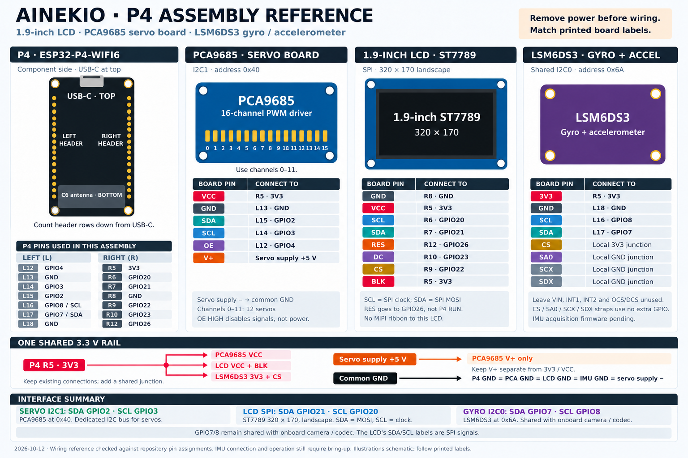

# P4, LCD, servo board and IMU assembly reference

Updated 2026-10-12 for the Waveshare ESP32-P4-WIFI6, selected 1.9-inch
ST7789 LCD, PCA9685 and photographed LSM6DS3 breakout.

[Open full-size PNG](Assembly_Reference.png). Board drawings are orientation
icons, not module connector layouts. Follow printed labels and the tables.
View the P4 component side with USB-C at the top and C6 antenna at the bottom.
L/R numbers count header rows down from USB-C; they are not GPIO numbers.
Remove power before changing connections.

For the added MG90 fourth-wire feedback module, use the separate
[CD74HC4067 wiring image](Multiplexer_Wiring.png)
([editable SVG](Multiplexer_Wiring.svg)). It shows the P4 connections, local
EN-to-GND jumper and owner's C4–C15 feedback input selection. The combined image
above predates this addition.

## Connection table

For the individual servo assignments, use the
[servo socket and feedback map](SERVO_SOCKET_MAP.md) ([image](Servo_Socket_Map.png)).
For the gyro board, use the dedicated
[LSM6DS3 wiring and calibration guide](LSM6DS3_IMU.md) ([image](LSM6DS3_Wiring.png)).
These October 18 references supplement the combined image without changing its wiring.

| Module | Module pin | P4 connection / local junction |
| --- | --- | --- |
| PCA9685 | VCC | R5 — 3V3 |
| PCA9685 | GND | L13 — GND |
| PCA9685 | SDA | L15 — GPIO2 |
| PCA9685 | SCL | L14 — GPIO3 |
| PCA9685 | OE | L12 — GPIO4 |
| PCA9685 | V+ | Existing separate 5 V servo supply positive |
| Servo supply | Negative | Common GND with PCA9685 and P4 |
| LCD | GND | R8 — GND |
| LCD | VCC | R5 — 3V3 |
| LCD | SCL | R6 — GPIO20, SPI clock |
| LCD | SDA | R7 — GPIO21, SPI MOSI |
| LCD | RES | R12 — GPIO26 |
| LCD | DC | R10 — GPIO23 |
| LCD | CS | R9 — GPIO22 |
| LCD | BLK | R5 — 3V3 |
| LSM6DS3 | 3V3 | R5 — 3V3 |
| LSM6DS3 | GND | L18 — GND |
| LSM6DS3 | SCL | L16 — GPIO8 |
| LSM6DS3 | SDA | L17 — GPIO7 |
| LSM6DS3 | CS | Local 3V3 junction |
| LSM6DS3 | SA0, SCX, SDX | Local GND junction |
| LSM6DS3 | VIN, INT1, INT2, auxiliary OCS/DCS | Unconnected |

R5 is a shared supply: retain PCA9685 VCC and LCD VCC/BLK, and branch to
IMU 3V3/CS. All module grounds and servo-supply negative are common.
PCA9685 V+ stays separate from the 3V3/VCC rail. OE disables PWM signals;
it does not disconnect servo power. Channels 0–11 of the 16-channel board
serve the twelve servos.

## Resolution of the apparent conflicts

- The LCD labels SCL/SDA mean SPI clock/data on GPIO20/21. Its RES goes to
  GPIO26, not the P4 RUN pin. This LCD uses the GPIO header, not the display ribbon.
- PCA9685 uses its dedicated I2C1 bus on GPIO2/3, address 0x40.
- IMU uses existing I2C0 on GPIO7/8, shared with codec/camera. CS high selects
  I2C; SA0 low selects address 0x6A. Local straps use no additional GPIOs.
- The old September P4 pinout's GPIO7/8 “reserved” label describes the onboard
  bus assignment; sharing that bus keeps its role. Its LCD GPIO allocations
  and servo-only power caption are superseded by this combined guide.

## Evidence and limits

LCD assignments were checked against `main/display.c`, `main/Kconfig.projbuild`
and local `sdkconfig` in the [P4 firmware](../../Slave/firmware/esp32p4-wifi6/).
Servo assignments come from `main/board.h`; shared I2C0 comes from
`components/ainekio_p4_media/media.c`. Physical header numbering follows the
[Waveshare board documentation](https://docs.waveshare.com/ESP32-P4-WIFI6).
IMU straps follow the [ST datasheet](https://pccomponents.com/datasheets/ST_MI-LSM6DS3TR.pdf)
and the photographed labels; direct 3V3 powering with VIN unused is also shown
by the [module implementation](https://github.com/nopnop2002/esp-idf-lsm6ds3#wireing).
Exact breakout regulator/schematic identification remains unconfirmed.

After this image was made, the owner connected the IMU with servos disconnected.
P4 application `0.8.17-p4-imu-probe` read address 0x6A, WHO_AM_I 0x69, and 207
six-axis samples in two seconds without an I2C error. Camera/audio initialization
also succeeded. Continuous acquisition is now implemented in
`0.8.18-p4-imu-live`; hand tilts support body forward = sensor -X,
left = sensor -Y and up = sensor +Z. Application `0.8.19-p4-imu-cal` now applies
that nominal mapping and measured stationary gyro bias from NVS. Persistence
across restart and corrected stationary readings were verified on the P4.
Precise mounting/accelerometer calibration, balance feedback and bus timing under
combined active media/network load remain bring-up work. No wiring change was
needed for this calibration update.
The image's pending-operation footer describes its earlier publication state.
See the [gait research journal](GAIT_RESEARCH_JOURNAL.md).

The PNG was produced with the built-in image generation tool, then visually
reviewed against these connection tables. The initial and final revision
[prompts](Assembly_Reference.prompt.txt) are retained for reproducibility.
The P4 pinout SVG/PNG was updated October 18 with all current external header
assignments, including feedback. [Open the current P4 pinout](ESP32P4_Pinout.png).
Other older individual diagrams retain their original publication context.
