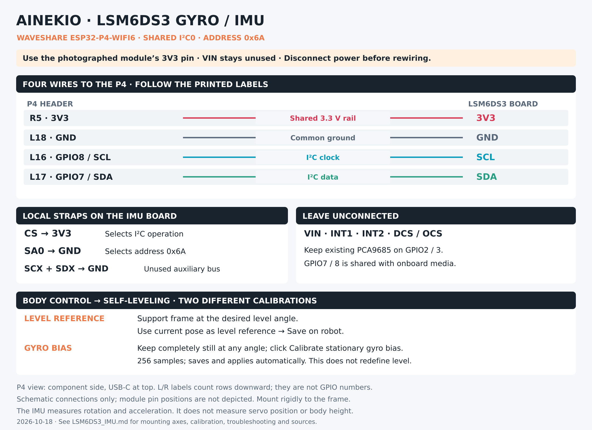

# LSM6DS3 gyro and accelerometer

Updated 2026-10-18 for the owner's photographed purple LSM6DS3 breakout and
Waveshare ESP32-P4-WIFI6. This records the installed wiring, existing firmware
support and Body Control calibration controls. The breakout's exact manufacturer
and regulator schematic remain unidentified; follow its printed pin labels.

[Full-size PNG](LSM6DS3_Wiring.png) · [Editable SVG](LSM6DS3_Wiring.svg)

## Wiring

With power removed, connect the following. P4 header rows count downward from
USB-C, viewed from the component side with the C6 antenna at the bottom.
L/R row numbers are guide labels, not GPIO numbers.

| IMU board label | Connect to | Purpose |
| --- | --- | --- |
| 3V3 | P4 R5 — 3V3 | Direct 3.3 V supply |
| GND | P4 L18 — GND | Common ground |
| SCL | P4 L16 — GPIO8 / SCL | I²C clock |
| SDA | P4 L17 — GPIO7 / SDA | I²C data |
| CS | Local 3V3 junction | Select I²C |
| SA0 | Local GND junction | Select address 0x6A |
| SCX | Local GND junction | Unused auxiliary clock |
| SDX | Local GND junction | Unused auxiliary data |
| VIN | Leave unconnected | This setup powers the 3V3 pin instead |
| INT1, INT2 | Leave unconnected | Firmware polls the sensor |
| DCS / OCS, as marked on the photographed board | Leave unconnected | Not used by this setup |

CS is the pin printed **CS**, distinct from the separate DCS/OCS marking.
The 3V3 and ground straps can share local junctions; they need no extra P4 GPIOs.
Retain the existing LCD, PCA9685 logic and multiplexer branches on the shared
3V3 rail. Do not connect IMU power to PCA9685 servo V+.

The IMU uses **I²C0 on GPIO7/8**, shared with the onboard media devices.
The PCA9685 remains on **I²C1, GPIO2/3**. The LCD's SCL/SDA labels mean SPI
clock/data on GPIO20/21; they are not this IMU bus. The historical P4 diagram's
“reserved” label on GPIO7/8 identifies the onboard bus, which this IMU shares.

## Mounting and axes

Mount the board rigidly to the frame so its angle follows the body. The earlier
hand-tilt checks established the nominal mapping **body forward = sensor −X,
body left = sensor −Y, body up = sensor +Z** for the tested installation.
This is installation-specific, not a universal breakout orientation.

After changing the board orientation, check Body Control's live readings:
raising the nose should increase pitch; raising the robot's left side should
increase roll. A level-reference capture changes the target angle; it cannot
repair swapped or reversed sensor axes. The stored mounting transform is
separate from the level target and stationary gyro bias.

## Level reference: tell the robot what level means

1. Support the frame at the angle you want it to hold. Use the frame as the
   reference, rather than assuming all four feet make the body level.
2. In **Body Control → Self-leveling**, click **Read from robot** and inspect
   **Live leveling feedback**.
3. Click **Use current pose as level reference**. This copies measured roll and
   pitch into the target fields.
4. Click **Save on robot** to apply and persist the targets and other displayed
   self-leveling settings, including its On/Off selection.

The displayed measured angles may remain nonzero: the target now matches those
angles. This does not zero the raw sensor axes or calibrate the gyroscope.

## Stationary gyro bias: remove rotation offset

Keep the entire robot still, including its legs. It may rest at any angle.
Click **Calibrate stationary gyro bias** in the same Self-leveling panel. The
existing firmware collects 256 samples, saves the measured bias and applies it
without restarting. Wait for the reported saved result. This action does not
move the robot or change the self-leveling switch; any actual movement during
sampling contaminates the result, so repeat while still if necessary.

This is a gyro zero-rate calibration. It is not a six-position accelerometer
calibration, a mounting-axis check, or the level-reference operation above.

## Reading the feedback

The panel displays sensor state, body tilt, error from the target, correction
activity and per-leg commanded extension/carrier/crank adjustments. Those leg
adjustments describe commands. Actual servo positions come from the separate
MG90 fourth-wire feedback system; they are not measured by the IMU.

The sensor supplies acceleration and angular velocity. Firmware estimates body
tilt from those readings. This does not directly measure body height, distance
walked, foot contact, motor current or available lifting torque. A body may be
level while all four legs are crouched. Self-leveling and measured-position
Stand are separate features with separate saved switches.

## Measured-joint leveling (0.8.65)

During stationary Stand, Self-leveling combines the IMU attitude target with
the calibrated MG90 feedback wires. The gyro controller calculates the desired
pose; each servo's measured position then supplies an additional correction
of half its target error. The correction is recalculated rather than accumulated.
It uses the existing joint mappings, including mirrored servo directions.
Existing linkage and speed feasibility checks reduce only this added correction
when necessary; the underlying gyro target remains intact.

Body Control reports whether measured-joint tracking is active, plus per-joint
target errors and applied corrections in degrees, grouped by physical leg.
This operates with feedback acquisition enabled and calibrated; it does not
require enabling the separate measured-position Stand sequencing switch.
Turning Self-leveling off disables this tracking too. Moving gaits retain their
existing gyro-only controller in this version.

If acquisition or calibrated readings are unavailable, the approved behavior is
to continue gyro-only leveling and report measured feedback unavailable. The
current acquisition interface does not reliably detect a disconnected wire
that floats at a plausible voltage, and this change adds no sample-age cutoff.
An available reading therefore is not proof of wire continuity or foot contact.

On 2026-10-18, the supported left-side-raised check read positive roll (19.35°).
The owner reported right legs extending. Neither sensor axes nor servo inversion
were changed in 0.8.65. That version was installed over Wi-Fi with calibration
preserved; the owner subsequently rejected both left/right and front/back
responses as reversed. The single-axis observation did not qualify physical
leveling, and the live controller accumulated an extreme pose without settling.

Historical firmware 0.8.66 reversed both P4 leveling response axes: left-up requested
left extension/right retraction; nose-up requests front extension/rear retraction.
It reverses attitude-error and angular-rate terms together, in stationary hold
and moving-gait correction. Raw IMU readings, saved level references, horn
mapping and measured-servo tracking retain their existing conventions. This is
an owner-requested response change, not a verified sensor mounting repair.
Native tests establish the requested command directions; physical convergence
has not been verified. The model's conventional planted-body convergence tests
remain separate and retain the original response polarity.

Firmware 0.8.67 corrects that reversal with the owner's approval after a
hard-right leveling failure. The outer controller now reduces body attitude
error: left-up shortens the left side and extends the right; nose-up shortens
the front and extends the rear. Joint-specific servo inversions remain in the
calibration mapper. Raw IMU axes, saved zero targets, Home pulses/model angles,
feedback curves, strength/damping and motion speed settings are unchanged.

New convergence tests exercise the actual P4 scheduler and feedback owner,
including mirrored mappings, shaft feedback, both tilt signs and nonzero saved
references on roll and pitch. Under the ideal planted-body model, a 4.58° error
converges to under 0.001°. Existing startup, loaded-error tracking, missing-data
behavior, moving-gait continuation and full native body tests pass. This is
software evidence; physical closed-loop settling remains to be verified.

## Quiet stationary hold (0.8.68)

Stationary Self-leveling now rests once both roll and pitch are within **0.5°**
of their saved targets and both angular rates are within **1°/s**. It holds the
achieved servo targets and resumes correction when either attitude error exceeds
**1°**. The separate settle and wake thresholds avoid repeatedly switching on
and off around the same angle. Body Control reports **Level reached — holding
position; tilt monitoring only**. New motion commands remain immediately usable.

While correction is active, measured-joint trim ignores errors within **120 µs**
of pulse-equivalent shaft position and applies half of only the excess error.
Raw feedback readings and saved calibration are unchanged. This initial tolerance
covers the approximately 112 µs peak-to-peak fluctuation observed in a short
stationary sample; that sample does not distinguish electrical noise from actual
servo hunting. The tolerance also leaves real tracking errors within that band
to the gyro controller rather than adding shaft trim.

Settled leveling skips inverse/forward kinematics, measured-joint conversion and
servo target writes. IMU monitoring and shared feedback acquisition remain
available to other features. The PCA9685 continues its existing PWM: this saves
repeated adjustment work, but does **not** switch off servo holding power.
Moving-gait balance and commanded motion speed/range are unchanged.

Production-owner tests cover noisy readings, held targets without repeated PWM
writes, wake on tilt, new commands and the existing unavailable-sensor behavior.
Firmware 0.8.68 is installed and reports settled with correction inactive.
Physical chatter reduction and disturbance recovery still need observation.

## Connection checks and evidence

If readings are unavailable, check 3V3/GND, SDA versus SCL, CS high and SA0 low.
Firmware expects address **0x6A** and identity **0x69**; identity is not the I²C
address. If readings update but tilt signs are wrong, investigate mounting axes.
If signs are correct but the robot holds an unwanted angle, review its saved
level targets. If commands appear but legs do not follow, inspect servo feedback
and mechanics separately.

Historical physical commissioning read address 0x6A / identity 0x69 and six-axis
samples, then verified saved mounting/bias persistence. Current source sets
208 Hz sensor output, ±16 g acceleration and ±2000°/s angular-rate ranges.
These are firmware configuration values, not guaranteed delivered sample rate
under every workload. This documentation update did not move or recalibrate the
robot. Current mounting and loaded correction performance need physical checks
after reassembly.

## Sources

- [Shared P4 bus owner](../../Slave/firmware/esp32p4-wifi6/components/ainekio_p4_media/media.c)
- [LSM6DS3 acquisition and gyro calibration](../../Slave/firmware/esp32p4-wifi6/components/ainekio_p4_media/imu.c)
- [Saved mounting and bias](../../Slave/firmware/esp32p4-wifi6/components/ainekio_p4_media/imu_calibration.c)
- [Body Control labels and calibration actions](../../Master/gateway/dashboard/static/dashboard.html)
- [Combined assembly reference and original board observations](ASSEMBLY_REFERENCE.md)
- [SparkFun LSM6DS3 hookup guide](https://learn.sparkfun.com/tutorials/lsm6ds3-breakout-hookup-guide/all): chip interface and unused SCX/SDX guidance; its breakout layout is different from the owner's board.
- [ST LSM6DS3 register definitions](https://github.com/STMicroelectronics/lsm6ds3-pid/blob/master/lsm6ds3_reg.h): sensor identity.
