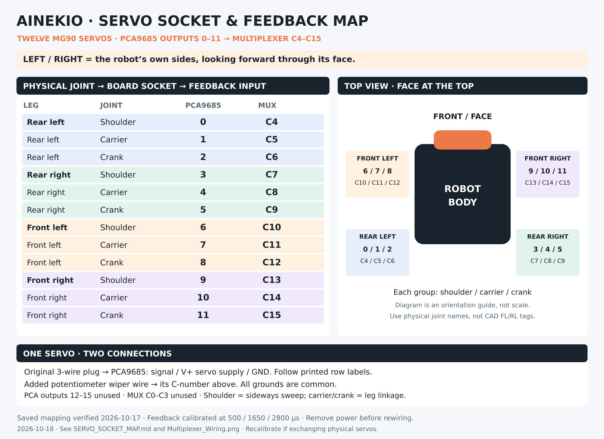

# Twelve-servo socket and feedback map

Updated 2026-10-18. This is the physical joint mapping saved and read back during
the 2026-10-17 loose-servo calibration. Left and right mean the robot's own
sides, looking forward through its face.

[Full-size PNG](Servo_Socket_Map.png) · [Editable SVG](Servo_Socket_Map.svg)

| Physical leg | Servo / joint | PCA9685 socket | CD74HC4067 input |
| --- | --- | --- | --- |
| Rear left | Shoulder | 0 | C4 |
| Rear left | Carrier | 1 | C5 |
| Rear left | Crank | 2 | C6 |
| Rear right | Shoulder | 3 | C7 |
| Rear right | Carrier | 4 | C8 |
| Rear right | Crank | 5 | C9 |
| Front left | Shoulder | 6 | C10 |
| Front left | Carrier | 7 | C11 |
| Front left | Crank | 8 | C12 |
| Front right | Shoulder | 9 | C13 |
| Front right | Carrier | 10 | C14 |
| Front right | Crank | 11 | C15 |

**Shoulder** sweeps the whole leg assembly sideways. **Carrier** drives the link
supporting the lower leg's knee pivot. **Crank** drives the short rotating arm
connected to the connecting rod. Each leg has these three separate servos.

## Connecting each servo

Remove power before moving connectors. Keep the original three-wire servo plug
on its numbered PCA9685 socket: signal to signal, positive to V+, ground to GND.
Follow the board labels for plug orientation. Put that same servo's added
potentiometer wiper wire on the matching C input above. The added wire carries
analog position feedback; it does not replace the original signal wire.

The rule for this saved setup is **multiplexer input = PCA9685 socket + 4**.
PCA9685 sockets 12–15 and multiplexer C0–C3 are unused. The two boards share
ground with the P4 and servo supply. PCA9685 servo V+ uses the separate servo
supply; multiplexer VCC uses P4 3V3.

See [multiplexer-to-P4 wiring](Multiplexer_Wiring.png) and
[PCA9685 power and logic wiring](PCA9685_WIRING.md).

## Calibration and naming

All twelve feedback curves were saved at **500, 1650 and 2800 µs**, followed by
checks at intermediate positions. These are unloaded feedback calibration
points, not proof that an assembled linkage can use every combination of joint
positions. See the [research journal](GAIT_RESEARCH_JOURNAL.md).

Keep each calibrated physical servo with its assigned output and feedback
input. If exchanging servos between joints, recalibrate the affected feedback
curves; their voltage-to-position relationships belong to the individual motors.
Refitting a horn changes mechanical indexing and may require motor geometry
calibration separately. Feedback calibration does not establish horn angle.

Use the physical names in this table. The legacy CAD naming reverses front/rear:
physical rear-left/right are CAD FL/FR; physical front-left/right are CAD RL/RR.
That CAD convention is not a reason to swap these plugs.

Joint names are defined in
[`joints_v2.py`](../../Slave/software/protocol/joints_v2.py). The saved motor map
read back during calibration assigned joint IDs 0–11 to PCA outputs 0–11;
feedback was separately saved as C4–C15. Body Control permits remapping, so
reconcile this guide if those saved assignments are changed later.
